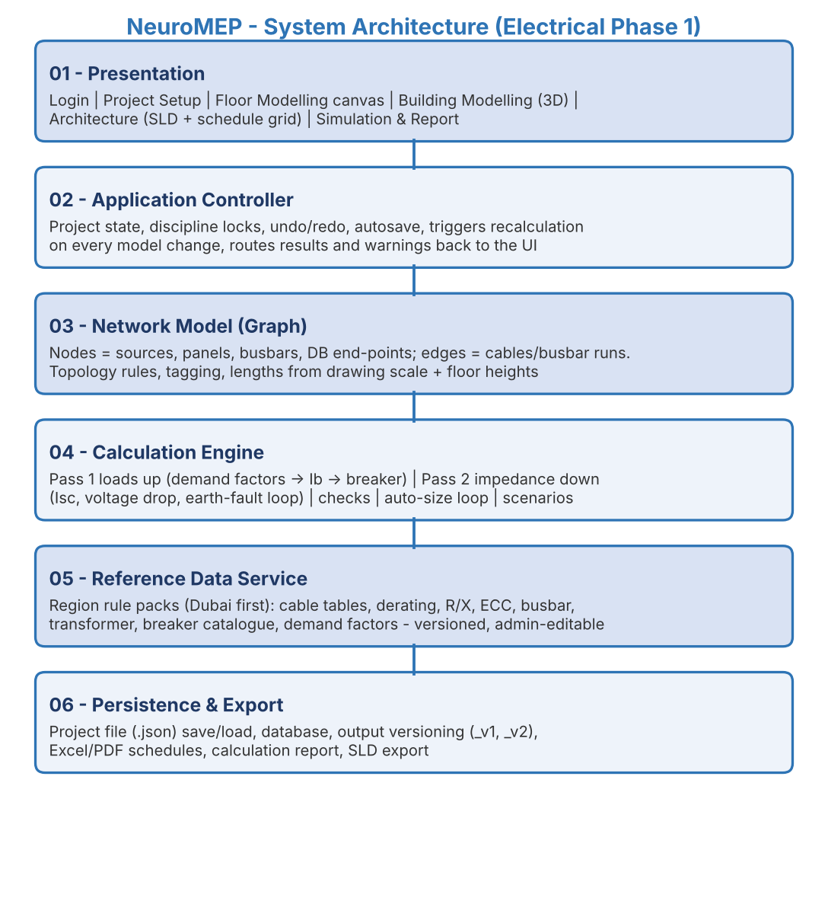

**Software Requirements & System Design Specification (SRS/SDD)**

**Project Name:** NeuroMEP - Connected MEP Design, Validation & Electrical Calculation Platform

**Release Covered:** Phase 1 - Electrical LV distribution, from the supply to the incoming feeder of each Distribution Board (DB)

**Document Version:** v0.8 - Freeze Candidate \| 22 October 2026 (becomes v1.0 when the items in Section 18 marked \"Blocking\" are closed)

**Prepared By:** NeuroMEP Development Team

**Target Environment:** Web application (browser, desktop screens); hosting on Netcup VPS

# **0. Document Control**

| **Version** | **Date** | **Change Summary** |
|---------|---------|-------------------------------------------------------|
| v0.1 | 21-Oct-2026 | Initial draft from CableSizer v1.1 (calculation file + manual), Components for NeuroMEP workbook, Project Set-up slide and UI screens. |
| v0.2 - v0.4 | 21-Oct-2026 | Live in-canvas calculation with Provisional/Final status and \"Sized by\"; engine as background service; Page 1 inputs reduced to the slide + floor heights; calculation defaults moved to the region rule pack. |
| v0.5 - v0.6 | 22-Oct-2026 | Floor-plan and calibration fields; altitude optional; only the Electrical engineer mandatory in Phase 1; project picker (D-13); MERN + TypeScript stack (D-14). |
| v0.8 | 22-Oct-2026 | v0.7 freeze candidate merged into the repository Markdown with: D-13 wording and project access rules (Section 2); FR-02 import by the Technical Lead; Page 1 validation ranges and "TBC does not block Next" (12.1); TBC demand factors taken as 1.0 and marked Provisional (10.3, D-19); Working Directory removed (D-18); load-type labels from the Project Set-up slide (Appendix B); Revit as a future plan source kind (12.1, 16). |
| v0.7 | 22-Oct-2026 | Independent verification of every calculation (Section 11) with corrected rules in Section 10; #TASK feature codes and error-code convention (Section 4); real-time multi-user collaboration with discipline greying (Section 8); tech stack and Netcup hosting (Section 7); component library from the POWER/LIGHT legend (Section 13); MAEC One and Revit future scope (Section 16); document condensed. |

**Source documents:** CableSizer v1.1 Calculation File and User Manual (W S Atkins, 2008); Components for NeuroMEP workbook; Project Set-up - Electrical slide; POWER/LIGHT legend sheet; NeuroMEP UI screens; DEWA Regulations for Electrical Installations 2017; IEC 60909-0, BS 7671, IEC 60364-5-52, IEC 60947-2 (as cited in Section 11).

# **1. Project Overview & Objectives**

**NeuroMEP** is a web application for MEP (Mechanical, Electrical, Plumbing/PHE) design engineers. Engineers import floor plans, place components from a library by drag-and-drop, connect them by drawing cables (in the style of Cisco Packet Tracer), and the application calculates, sizes and validates every breaker and cable continuously in the background, then produces the fixed-format panel schedules contractors build from. It replaces manual mark-up of floor plans and the spreadsheet calculation tool CableSizer.

| **Objective** | **What It Means** |
|------------------|------------------------------------------------------|
| Eliminate manual calculation | Load summation, currents, breakers, cables, voltage drop, fault levels and earth-fault checks are calculated automatically from the drawn model. |
| Verified, standards-based results | Every formula is defined in Section 10 and verified in Section 11 against IEC 60909, BS 7671 / IEC 60364 and DEWA rules. |
| Live, connected model | Any change (load, length, cable, new upstream panel) re-sizes every affected cable above and below it within half a second. |
| Multi-discipline collaboration | Electrical, mechanical and PHE engineers work on the same floor at the same time with live sync, Google-Sheets style. |
| Safety rules enforced | Fire & life-safety (FLS), essential and critical loads checked for correct sources and fire-rated cabling along the whole path. |
| Traceability | Every feature has a #TASK code; every calculated value shows its inputs, table values and formula; every error carries a code. |

## **Product Roadmap**

| **Phase** | **Content** |
|-----------------|-------------------------------------------------------|
| Phase 1 (this document) | Electrical LV distribution: transformer / generator / UPS -\> LV panel / MDB -\> busbar risers -\> SMDB / MCC -\> DB incoming feeder. DB is an end point with entered load. |
| Phase 2 | DB internal circuits and final circuits (lighting, sockets, small power) using the legend devices; mechanical and PHE layers editable with their own calculations. |
| Future | NeuroMEP as a sub-application of MAEC One; Revit connector and NeuroMEP-inside-Revit plug-in (Section 16). |

# **2. Users, Roles & Discipline Layers**

| **Role** | **Access** | **Responsibilities** |
|-------------------|--------------|----------------------------------------|
| Technical Lead / Project Admin | Full project access | Creates project, completes Project Set-up, assigns discipline engineers, overrides calculation defaults, approves issue. |
| Electrical Engineer (required) | Edit Electrical layer | Places electrical components, draws cables, enters DB loads, reviews results, locks sizes, exports schedules. |
| Mechanical Engineer (optional in Phase 1) | Edit Mechanical layer | Places mechanical equipment and enters its electrical data (kW, phases, pf, load category) which feeds the electrical model. |
| PHE Engineer (optional in Phase 1) | Edit PHE layer | As above for pumps, fire pumps and PHE equipment. |
| Checker / Reviewer | Read + comment | Verifies results and signs revisions. |
| System Administrator | Reference data, users | Maintains rule packs, lookup tables, breaker catalogue, demand-factor defaults, component library and symbols. |

**Discipline layers:** each component belongs to one discipline layer. A user can edit only the layers of their discipline; other layers are visible but greyed out and read-only, and update live as their owners work (Section 8). Authentication sits behind a provider interface so that MAEC One unified login can be plugged in later (Section 16).

**Project access (interim until OI-28):** the Technical Lead, Checker and System Administrator see every project; discipline engineers see the projects they created or are assigned to. Only the Technical Lead creates or imports projects and edits Project Set-up (Page 1); other roles see Page 1 read-only.

# **3. Scope & Electrical Hierarchy**

| **Level** | **Equipment** | **Fed From** | **Feeds** |
|--------------|-----------------------|----------------|--------------------|
| L0 Supply | EB Utility / RMU (HV) | Grid (fault level input) | Transformer |
| L1 Source | Transformer; Generator via ATS; UPS for critical loads | RMU / ATS / panel | LV Panel / MDB |
| L2 Main distribution | LV Panel, MDB, ACB panel, ESMDB | Transformer / ATS | Busbars, SMDBs, MCCs, PFC bank, isolators, DBs |
| L3 Riser | Busbar (feeder or tap-off type), tap-off boxes | MDB | SMDBs, DBs |
| L4 Sub-main | SMDB, ESMDB, MCC, EMCC | MDB / tap-off box | DBs, isolators, motors |
| L5 Terminal (Phase 1 end) | DB, isolator, connection unit | SMDB / MCC / MDB | Not modelled in Phase 1 (load entered as totals) |

| **Element** | **Allowed Upstream** | **Allowed Downstream** | **Rules** |
|---------------|-------------------|--------------------|-------------------|
| Transformer | RMU | LV Panel / MDB / feeder busbar | 4P incomer |
| Generator / ATS | Generator: none; ATS: normal + standby input | ESMDB / LV Panel | ATS has exactly two inputs and one output |
| LV Panel / MDB | Transformer, ATS | Busbar, SMDB, MCC, DB, PFC, UPS, isolator | Max 25 ways, warning above 18; up to 2 incomers |
| Busbar feeder / tap-off | MDB | Feeder: one panel; tap-off: tap-off boxes only | Tap-offs only on tap-off type |
| SMDB / MCC | MDB, tap-off box | DB, isolator, connection unit, motors | As panel |
| DB, isolator, connection unit | SMDB, MDB, MCC, tap-off, UPS | \- (Phase 2) | Terminal in Phase 1 |

The network is radial (no loops); each element has exactly one active supply per scenario; single-phase elements take one phase of a three-phase panel (automatic allocation with manual override).

# **4. Feature Task Codes & Error-Code Convention**

Every feature has a permanent code **#TASK-nn**. The code is used in requirement IDs, backlog tickets, branch names and commit messages (e.g. \"#TASK-22 fix single-phase r/x lookup\"), test names, log lines and error codes, so any failure can be traced to its feature in seconds. Codes are never reused or renumbered; retired features keep their code with status \"Retired\".

| **Code** | **Feature** | **Page / Layer** | **FRs** | **Error Range** |
|-----------|----------------------------|------------|-----------|-----------|
| #TASK-01 | Authentication, session, roles | Login | FR-01 | E0101-E0199 |
| #TASK-02 | Project picker (list, create, import) | After login | FR-02 | E0201-E0299 |
| #TASK-03 | Project details & site conditions | Page 1 | FR-03 | E0301-E0399 |
| #TASK-04 | Calculation set-up, region, demand factors, defaults panel | Page 1 | FR-04, FR-05 | E0401-E0499 |
| #TASK-05 | Floor registry & elevations | Page 1 | FR-06 | E0501-E0599 |
| #TASK-06 | Floor-plan upload & viewer | Page 1 | FR-07 | E0601-E0699 |
| #TASK-07 | Scale calibration & plan replacement | Page 1 | FR-08, FR-09 | E0701-E0799 |
| #TASK-08 | Project persistence, autosave, versioning, optimistic locking | API | FR-10 | E0801-E0899 |
| #TASK-09 | Real-time sync & presence | All modelling pages | FR-11 | E0901-E0999 |
| #TASK-10 | Discipline layers, greying, element locks | All modelling pages | FR-12 | E1001-E1099 |
| #TASK-11 | Component library & legend symbols | Page 2 | FR-13 | E1101-E1199 |
| #TASK-12 | Placement & auto-tagging | Page 2 | FR-14 | E1201-E1299 |
| #TASK-13 | Cable drawing, routing & length | Page 2 | FR-15 | E1301-E1399 |
| #TASK-14 | Topology rules & connection validation | Pages 2-3 | FR-16 | E1401-E1499 |
| #TASK-15 | DB / equipment load entry | Page 2 | FR-17 | E1501-E1599 |
| #TASK-16 | Properties panel & live results | Pages 2-4 | FR-18 | E1601-E1699 |
| #TASK-17 | Floor stacking & 3D view | Page 3 | FR-19 | E1701-E1799 |
| #TASK-18 | Risers, sources, ATS, network completeness | Page 3 | FR-20 | E1801-E1899 |
| #TASK-19 | Engine: load aggregation & demand factors | Engine | FR-21 | E1901-E1999 |
| #TASK-20 | Engine: design current & protective devices | Engine | FR-22 | E2001-E2099 |
| #TASK-21 | Engine: current-carrying capacity & derating | Engine | FR-23 | E2101-E2199 |
| #TASK-22 | Engine: voltage drop | Engine | FR-24 | E2201-E2299 |
| #TASK-23 | Engine: short-circuit (max, min, peak, withstand) | Engine | FR-25 | E2301-E2399 |
| #TASK-24 | Engine: thermal withstand (let-through) | Engine | FR-26 | E2401-E2499 |
| #TASK-25 | Engine: earth-fault loop & disconnection | Engine | FR-27 | E2501-E2599 |
| #TASK-26 | Engine: auto-sizing, live run, provisional mode | Engine | FR-28 | E2601-E2699 |
| #TASK-27 | Engine: scenarios & safety-category rules | Engine | FR-29 | E2701-E2799 |
| #TASK-28 | Engine: PFC, generator, transformer loading, tray | Engine | FR-30 | E2801-E2899 |
| #TASK-29 | Reference data, rule packs & admin | Admin | FR-31 | E2901-E2999 |
| #TASK-30 | Single-line diagram, schedule grid, overrides | Page 4 | FR-32 | E3001-E3099 |
| #TASK-31 | Scenario review, exports & output versioning | Page 5 | FR-33 | E3101-E3199 |
| #TASK-32 | Audit log, error logging & monitoring | API | FR-34 | E3201-E3299 |
| #TASK-33 | Revit connector (future) | Revit add-in | Section 16 | E3301-E3399 |
| #TASK-34 | MAEC One integration (future) | Platform | Section 16 | E3401-E3499 |

## **Error & Log Code Convention**

- **Error code:** E + task number (2 digits) + sequence (2 digits), e.g. **E2203** = third error of #TASK-22 (voltage drop). Each code is listed once in the code catalogue (\`packages/shared/errors\`) with message, severity and suggested action.

- **Calculation check codes:** C1-C12 (Section 10.12) identify which check failed on an element; they appear in the properties panel, schedules and reports.

- **Log line format:** \`\[timestamp\] \[level\] \[#TASK-nn\] \[Ennnn\] message {projectId, floorId, elementTag, userId, rulePackVersion}\`. Levels: DEBUG, INFO, WARN, ERROR. The user sees the message and code; support sees the full context.

- **Engine trace:** every engine run carries a run ID; each element result stores the run ID, rule-pack version and the codes of checks evaluated, so a reported result can be replayed exactly.

# **5. Functional Requirements**

| **ID** | **Task** | **Pri.** | **Requirement** |
|--------|-----------|-------|-----------------------------------------------|
| FR-01 | #TASK-01 | High | Sign-in with email and password behind an AuthProvider interface (dev provider now, MAEC One later); masked password with show/hide; generic error message; session persists across reloads; protected routes; \"Demo credentials\" shown only in development builds. |
| FR-02 | #TASK-02 | High | After login, a project picker lists accessible projects (name, client, stage, revision, last modified); the Technical Lead can create a project or import a project file (.json) - an import creates a new project; opening a project goes to the page last used in it (D-13). |
| FR-03 | #TASK-03 | High | Capture project details and site conditions (Section 12.1) with inline validation; region defaults tagged as such. |
| FR-04 | #TASK-04 | High | Region selection loads the rule pack (Dubai active; others disabled). Calculation check-boxes control enforcement; disabled checks are still computed and shown \"Not verified\". Read-only \"Calculation defaults\" panel (12.2), overridable by the Technical Lead with audit. |
| FR-05 | #TASK-04 | High | Demand-factor tables (12 load types; Residential/Landlord/Office/Retail) pre-filled from the rule pack, editable per project and per panel; unknown values shown as \"TBC\", never invented. TBC values do not block Next; while any factor is TBC, Page 1 shows a warning banner (D-19). |
| FR-06 | #TASK-05 | High | Floor registry generated from floor counts (B1..Bn, GF, P1..Pn, typical, mechanical tags); GF datum level, floor-to-floor heights and cumulative levels; changing counts never deletes floors with plans without confirmation. |
| FR-07 | #TASK-06 | High | One PDF plan per floor; vector rendering with zoom, fit and pan; plan status No plan / Uncalibrated / Calibrated. |
| FR-08 | #TASK-07 | High | Two-point scale calibration (or drawing-scale entry, marked less reliable) stored in PDF coordinates as metres per drawing unit; optional verify measurement; lengths are not calculated on uncalibrated floors. |
| FR-09 | #TASK-07 | Med. | Replacing a plan keeps the model, requires re-calibration and alignment to the previous plan by a common reference point, recalculates lengths, and flags components outside the new extents. |
| FR-10 | #TASK-08 | High | Projects saved in the database and exportable/importable as .json (schemaVersion, rulePackId/version); autosave; undo/redo of own actions; optimistic locking by element version. |
| FR-11 | #TASK-09 | High | Real-time collaboration: every change by any user appears for all users on the same project within 1 second, with presence (who is on which floor) and selection highlights (Section 8). |
| FR-12 | #TASK-10 | High | Discipline greying: components and library tabs of other disciplines are greyed out and read-only; an element being edited by another user shows that user and is locked until released. |
| FR-13 | #TASK-11 | High | Bottom component library with tabs All / Electrical / Mechanical / PHE using the company legend symbols (Section 13); Phase 2 items visible but disabled. |
| FR-14 | #TASK-12 | High | Drag-and-drop placement with automatic equipment tags (Section 12.4). |
| FR-15 | #TASK-13 | High | Port-to-port cable drawing with orthogonal multi-point routing; length = routed length x scale + vertical runs + length allowance. Drawing from a panel creates an outgoing way with circuit reference (1RYB, 2R\...). Cable construction is chosen while drawing (project defaults); size is never picked by the user. |
| FR-16 | #TASK-14 | High | Topology rules of Section 3 enforced on connect; illegal connections refused with message and code. |
| FR-17 | #TASK-15 | High | DB load per phase and load type, or area x W/m2 per phase, with load category, demand category and power factor; mechanical/PHE equipment supplies kW, phases, pf, efficiency and starter type. |
| FR-18 | #TASK-16 | High | Selecting any element shows its properties and live results: size, runs, ECC, breaker, Ib/In/Iz, voltage drop (own and total), fault levels, each check, status Provisional/Final, the deciding check (\"Sized by\"), lock buttons and the full calculation trace. |
| FR-19 | #TASK-17 | High | Floors stacked by elevation in a 3D isometric view with discipline colours. |
| FR-20 | #TASK-18 | High | Risers (busbar or cable) defined by shaft and floors served, lengths from elevations; connection of risers, MDB, transformer, generator via ATS, UPS, PFC; network completeness validation. |
| FR-21 to FR-30 | #TASK-19 to 28 | High | Calculation engine as specified in Section 10: a background service with no page that recalculates the affected network after every change and the whole project after any set-up change; unlocked items re-solved from minimum size each run; locked items validated only; all failing checks reported. |
| FR-31 | #TASK-29 | High | Versioned rule packs and lookup tables with reference conditions, edited only by the System Administrator with audit; a project records the version it used. |
| FR-32 | #TASK-30 | High | Architecture page: single-line diagram and schedule grid in the formats of Section 14; only input cells editable; edits synchronised with the canvas; locks and per-panel demand-factor overrides. |
| FR-33 | #TASK-31 | High | Simulation & Report: normal and standby scenarios, final check list (failures, warnings, Not verified, overrides), exports in Excel/PDF with title block; files never overwritten (\_v1, \_v2). |
| FR-34 | #TASK-32 | High | Structured logging with task and error codes (Section 4); audit of set-up, demand-factor, default and lock changes. |

# **6. Non-Functional Requirements**

| **Area** | **Requirement** |
|---------------|---------------------------------------------------------|
| Performance | Properties panel updated within 0.5 s of an edit; full recalculation of 2,000 elements within 1 s; collaboration updates visible to other users within 1 s. |
| Calculation accuracy | Continuous results within +/-0.5 % of the hand-checked reference project; discrete selections identical. No result is produced from a missing or out-of-range table value - the element is blocked with a code. |
| Determinism & traceability | Same model + rule-pack version = identical results on every client and the server; every result replayable from its run ID. |
| Concurrency | At least 10 simultaneous users per project without conflicts or lost edits. |
| Reliability | Autosave; no more than 1 minute of work lost on browser failure; daily database backups on the VPS with off-site copy. |
| Security | Role- and discipline-based access; HTTPS; httpOnly session cookies; audit log; project data stays on company infrastructure. |
| Usability & compatibility | Plain-language messages with codes; colour always paired with text; latest Chrome/Edge; minimum 1920 x 1080. |
| Maintainability | Engine is an isolated TypeScript package with pure functions and full unit tests (Appendix C vectors). |

# **7. System Architecture & Technical Stack**

| **Layer** | **Responsibility** |
|-----------------|-------------------------------------------------------|
| 01 Presentation | Login, project picker, Pages 1-5, properties panel, schedule grid. |
| 02 Application controller | Project state, undo/redo, autosave, discipline locks, collaboration client, dispatch of changes to the engine worker. |
| 03 Network model | Graph of nodes (sources, panels, busbars, tap-offs, DB end points) and edges (cables, busbar runs); topology rules; tags; lengths. |
| 04 Calculation engine | Background service, no page: aggregation, Ib, devices, ampacity, voltage drop, faults, withstand, earth-fault, auto-size, scenarios. Same package runs in a browser Web Worker and on the server. |
| 05 Reference data | Versioned rule packs and lookup tables with reference conditions. |
| 06 Persistence, sync & export | REST API, real-time socket server, MongoDB, file storage, exports. |

| **Area** | **Choice (D-14)** |
|---------------|---------------------------------------------------------|
| Repository | One TypeScript repository with npm workspaces: apps/web, apps/api, packages/engine, packages/shared, packages/rulepacks; revit-addin/ (future, C#). |
| Front end | React + TypeScript (Vite); Zustand state; Konva canvas; PDF.js for plans; three.js for the 3D view; Zod forms; Socket.IO client; engine in a Web Worker. |
| Back end | Node.js (current LTS) + Express in TypeScript; Socket.IO for real-time sync and presence; Zod validation shared with the front end. |
| Database | MongoDB as a replica set (needed for transactions and change streams) with the official driver; collections: projects, floors, elements, rulepacks, auditLog, exports, sessions. PDFs and exports in GridFS (object storage later). |
| Calculation engine | packages/engine - pure TypeScript, no UI or database imports; identical results in browser and server. |
| Exports | ExcelJS for schedules; HTML-to-PDF renderer for reports (library chosen at implementation). |
| Testing & quality | Vitest (unit), mongodb-memory-server (database), Playwright (end-to-end, collaboration with two browsers); ESLint + Prettier; CI on every push. |
| Hosting | Netcup VPS: Nginx reverse proxy with HTTPS (WebSocket upgrade enabled), Node API under PM2 or Docker, MongoDB replica set on the VPS (or Atlas), nightly backups; staging and production environments. |
| Future | Revit add-in in C# .NET (Section 16); MAEC One authentication via the AuthProvider interface. |

# **8. Real-Time Collaboration Design**

Several engineers (for example electrical and mechanical) can work on the same project and the same floor at the same time. Every change appears for everyone almost immediately, like Google Sheets, and nobody can overwrite another discipline\'s work.

| **Topic** | **Design** |
|---------------|---------------------------------------------------------|
| Channels | Each open project is a Socket.IO room; each floor a sub-room. Clients send operations (add, move, delete, connect, edit property); the server validates permission and version, stores the change in MongoDB and broadcasts it to the room. The server is the single source of truth. |
| Discipline greying | Each element and library tab belongs to a discipline layer. For an electrical engineer, mechanical and PHE elements and tabs are greyed out and read-only (and vice versa); they still move, appear and disappear live as their owners work. |
| Presence | Avatars show who is on which floor; each user\'s current selection is outlined in their colour with their name. |
| Element locks | Selecting an element for editing takes a soft lock: other users see it greyed with \"Being edited by \<name\>\". The lock is released on deselect, after 60 s idle, or on disconnect. |
| Conflicts | Every element carries a version number; an operation based on an old version is rejected (E0902) and the client reloads that element. Locks make this rare. |
| Cross-discipline data | When a mechanical engineer changes an AHU\'s kW, the electrical model updates for everyone and the engine re-sizes affected cables; the electrical engineer gets a notice listing the changed elements. |
| Calculation consistency | Each client runs the same engine version on the same synchronised model and rule-pack version, so all users see identical results; the server re-runs the engine on save/export and logs any mismatch (E2690). |
| Disconnection | On connection loss the canvas becomes read-only with a \"Reconnecting\" banner; after reconnection missed operations are replayed. No offline editing in Phase 1. |
| Undo / redo | Per user, own operations only. |
| Scaling | One API instance is sufficient for Phase 1; a Redis adapter for Socket.IO is added if the API is scaled to several instances. |

# **9. Pages & End-to-End Workflow**

| **Page** | **Purpose** | **Main Steps** | **Exit Condition** |
|--------------|--------------|--------------------------------|--------------|
| Login | Authenticate | Email + password; roles loaded. | Valid session |
| Project picker | Choose or create project | Open (goes to the project's last page); create or import .json (Technical Lead). | Project selected |
| 1 Project Set-up & Import Floor Plan | Project data, calculation set-up, floors, plans | Details and site conditions; region, fault level, checks, demand factors; floor counts -\> registry with levels and heights; discipline assignment; PDF per floor and calibration. | Required fields valid; registry complete; at least one floor calibrated |
| 2 Floor Modelling | Model each floor | Place components; draw cables (construction only); enter DB and equipment loads; live sizes and checks in the properties panel (Provisional until the path reaches a source). | No unconnected components or rule violations on the floor |
| 3 Building Modelling | Complete the building network | Stack floors in 3D; define risers and tap-offs; connect to MDB, transformer, generator (ATS), UPS, PFC; results turn Final. | Network complete and valid |
| 4 Architecture | Review and override | Single-line diagram; schedule grid; lock sizes; per-panel demand factors; phase allocation. No separate calculation step. | Reviewed |
| 5 Simulation & Report | Issue | Standby (generator) scenario; final check list; exports with title block and versioned names. | Issued |

# **10. Electrical Calculation Specification (Verified)**

This section defines the engine. It follows the CableSizer method where that method was verified correct, and applies the corrections found in the independent verification (Section 11, items V-nn). Items marked **\[ENG\]** need confirmation by the Senior Electrical Engineer before v1.0.

## **10.1 Conventions**

| **Item** | **Rule** |
|-----------------|-------------------------------------------------------|
| Units | V (400 three-phase / 230 single-phase), A, kW, kVA, kVAr, mOhm (per metre: mOhm/m), kA, mm2, m, deg C, K.m/W. Full precision internally; rounding only for display (currents 1 dp, % 2 dp, kA 2 dp, mOhm 3 dp). |
| Voltage factor (V-03) | Maximum fault currents use cmax = 1.10; minimum fault currents use cmin = 0.95 (BS 7671 Cmin for Zs) - DEWA declares 230/400 V +/-10 %. \[ENG\] |
| Missing data | A missing, blank or out-of-range table value never becomes 0 or 1: the element is blocked with an error code (V-14). |
| Between table steps | Temperature, soil resistivity and depth factors are interpolated linearly inside the table range; outside the range the element is blocked. \[ENG\] |

## **10.2 Calculation Order (runs after every change)**

1\. Identify supply paths; elements without a path to a source run in Provisional mode (10.13). 2. Pass 1 (bottom-up): connected load per phase and load type, demand factors, maximum demand. 3. Ib for every cable and busbar run; device selection. 4. Starting cable size: locked size, else the regional minimum for the breaker. 5. Pass 2 (top-down): impedances, maximum and minimum fault currents, peak current, cumulative voltage drop, earth-fault loop. 6. Checks C1-C12 on every element; upsize failing unlocked cables; repeat steps 3-6 until nothing changes (all checks re-run each iteration, because a larger upstream cable raises downstream fault levels). 7. Standby scenario and ancillary results.

## **10.3 Load Aggregation & Demand Factors**

DB: connected load per phase and load type (entered, or area x W/m2). Panel: connected load = sum of downstream connected loads per phase and type; demand = connected x demand factor of the type, applied once at each panel to the downstream connected load (factors are never multiplied down the tree); maximum demand = sum over types. How load-type and category factors combine is open (OI-02). **Until OI-01 is closed (D-19):** a missing (TBC) demand factor is taken as 1.0 (no diversity - conservative) and every result that depends on it is labelled \"Provisional - demand factors TBC\" and never becomes Final. This is the only exception to the missing-data rule of 10.1 (V-14). Transformer MD = MD of the panels it feeds; generator MD calculated per standby scenario (10.14).

## **10.4 Design Current Ib**

| **Case** | **Rule** |
|----------------------|--------------------------------------------------|
| Three-phase balanced | Ib = P x 1000 / (sqrt3 x 400 x pf) |
| Single-phase (L-N) | Ib = P x 1000 / (230 x pf) |
| Line-to-line load (V-04) | Ib = P x 1000 / (400 x pf). The legacy \"two-phase\" formula is removed; the connection type is modelled explicitly. |
| Panel / feeder with unbalanced phases (V-05) | Ib = largest phase current = max(P_phase x 1000 / (230 x pf)); neutral current reported. |
| Motor (V-06) | Ib = P_out x 1000 / (sqrt3 x 400 x pf x efficiency), or nameplate full-load current if entered. Default efficiency by motor class. \[ENG\] |
| Star-delta starter (V-07) | Supply cable and breaker: line current as above. Two motor-side cable sets: line current / sqrt3. Overload relay set at 0.58 x full-load current. |
| Capacitor (PFC) bank (V-08) | Ib = 1.5 x Q x 1000 / (sqrt3 x 400) (minimum factor 1.43, IEC 60831); detuned banks use the manufacturer factor. The legacy division by sin(phi) is removed. |

## **10.5 Protective Devices**

| **Item** | **Rule** |
|-------------------|-----------------------------------------------------|
| Rating | Ib \<= In \<= Iz (BS 7671 433.1.1). In = lowest standard rating \>= Ib (Appendix B); for adjustable trip units In = the Ir setting. Breakers in panels at 50 deg C are derated per manufacturer (V-22). |
| Type & poles | MCB/MCCB below 800 A, ACB at 800 A and above; MCP for motors. 1P single-phase, 3P three-phase, 4P sources and main incomers. |
| Magnetic threshold Im (V-09) | Taken from the breaker catalogue for the selected trip unit and setting (OI-03). The legacy rule \"Im = n x frame\" is removed. For checks use Ia = 1.2 x Im (IEC 60947-2 +/-20 % tolerance) unless the manufacturer states another tolerance. |
| Breaking & making capacity (V-10) | Icu (or Ics if specified) \>= maximum Ik at the panel where the breaker is installed; Icm \>= peak current ip. |
| Earth leakage | 30 mA / 100 mA ELCB, 0-300 / 0-500 mA ELS - shown in Remarks. |

## **10.6 Current-Carrying Capacity (C1)**

Iz = It x K1 x K2 (x Kr x K3 for buried) x number of runs; pass if Iz \>= In. Every rating table is stored with its reference conditions (air temperature, ground temperature, soil resistivity, depth, installation arrangement) and derating factors are taken only from tables with the same reference (V-11). The CableSizer ampacity tables contain data errors (method B equal to free air, 300 mm2 rated below 240 mm2, single-core columns spliced and buried single-core copied from four-core) and **must be replaced by verified manufacturer (Ducab) or BS 7671 Appendix 4 tables before release (V-12, OI-07)**. Grouping factors outside the tabulated range (e.g. more than 3 trefoil circuits) block the result (V-13). Parallel runs must be identical in type, length and arrangement; otherwise an unequal-sharing derating applies (V-23).

## **10.7 Voltage Drop (C2)**

Unit drop Vu = r x cos(phi) + x x sin(phi) (mV/A/m), with r and x taken from tables keyed by phases, cores, arrangement (trefoil / flat / spaced), insulation and size (V-15); single-phase values are the two-conductor values (= 2/sqrt3 x three-phase). Circuit drop Vc = Ib x L x Vu / (1000 x runs); cumulative Vt = Vc + upstream Vt; %Vt = Vt / Vn. Busbars use R and X per metre with the load power factor (V-16). Cumulative limits (Dubai rule pack): MDB, SMDB, busduct, MCC 2.0 %; DB 2.5 %; motors and final circuits 4.0 % (DEWA 4 % total).

## **10.8 Short-Circuit Current (C3) - IEC 60909**

| **Element** | **Impedance (mOhm)** |
|-----------------|-------------------------------------------------------|
| Upstream network (V-17) | ZQ = cQ x Vn\^2 / (S\"kQ x 1000), cQ = 1.1; XQ = 0.995 ZQ; RQ = 0.1 XQ. DEWA maximum S\"k for duty checks, minimum for protection checks. |
| Transformer (V-18) | ZT = uk x Vn\^2 / (S x 100); RT = ur x Vn\^2 / (S x 100); XT = sqrt(ZT\^2 - RT\^2); multiplied by KT = 0.95 x cmax / (1 + 0.6 xT). uk, ur from datasheet; default uk = IEC 60076-5 minimum (\<=630 kVA 4 %, 631-1250 5 %, 1251-2500 6 %, 2501-6300 7 %). |
| Generator (V-19) | Maximum: X\"d with RG = 0.15 X\"d and KG (IEC 60909). Minimum (protection checks on standby supply): the sustained short-circuit current from the generator datasheet. |
| Cable (V-20) | R from IEC 60228 resistance at 20 deg C per size / runs (maximum); at end-of-fault temperature for minimum. X from the manufacturer per arrangement (typical multicore 0.08, trefoil 0.085, flat 0.095 mOhm/m). |
| Busbar | R and X per metre from the busbar manufacturer datasheet. |
| Motor group (V-21) | ZM = Vn\^2 / (IL/IF x SrM); XM = 0.922 ZM; RM = 0.42 XM (IEC 60909; the CableSizer sheet was right, the manual wrong). SrM = sum P / (efficiency x pf). Combined in parallel with the network. |

Ik\"max = cmax x Vn / (sqrt3 x Zk) at every node; Ik\"min with cmin, hot conductors and minimum source. Peak ip = kappa x sqrt2 x Ik\", kappa = 1.02 + 0.98 e\^(-3R/X). Single-phase circuits also get the line-to-neutral fault. **Checks:** breaker Icu \>= Ik\"max and Icm \>= ip at the installation point; switchboard and busbar short-time withstand Icw (1 s) \>= Ik\"max and Ipk \>= ip (DEWA 40 kA / 1 s minimum) (V-10).

## **10.9 Thermal Withstand / Let-Through (C4)**

k\^2 x S\^2 \>= I\^2t, checked at both ends (V-24): (i) at the cable origin with the maximum fault current and the device let-through I\^2t from the catalogue (or Ik\"max\^2 x t, where t is the actual clearing time including any short-time delay); (ii) at the far end with the minimum fault current and its clearing time from the trip curve. The legacy fixed 0.05 s at the far-end current is removed. The transformer-to-MDB cable uses the clearing time of the MV protection (OI-31). k values (BS 7671 Table 43.1): Cu/XLPE 143; Cu/PVC 115 (\<=300 mm2), 103 (\>300); Al/XLPE 94; Al/PVC 76 / 68. Earth conductors use the k table for their type (Tables 54.2-54.4).

## **10.10 Earth-Fault Loop & Disconnection (C5)**

Loop per metre: Rc (phase) + Rp (ECC in parallel with armour) and loop reactance = sum of phase and protective-conductor reactance (V-25; the legacy average is removed). Zs = upstream loop + loop per metre x L. Hot values use the factors 1.38 (PVC) / 1.60 (XLPE), armour 1.19 / 1.28, x1.1 for steel wire (conservative). **Pass if Zs(hot) \<= 0.95 x 230 / Ia** (V-26), where Ia is the current that disconnects within the required time: 5 s for distribution circuits (all Phase 1 feeders), 0.4 s for final circuits (Phase 2). Ia comes from the device curve; if only the instantaneous threshold is known, Ia = 1.2 x Im. The minimum earth-fault and line-to-line currents (cmin, hot) must reach Ia (V-27). Checked for both normal and standby supply; failure on generator supply suggests an earth-fault relay or RCD.

## **10.11 Regional Minimum Size (C6)**

Installed size x runs \>= the DEWA minimum for the breaker rating (Appendix B). This is also the starting size of the auto-sizing loop.

## **10.12 Check Codes**

| **Code** | **Check** | **Fail Condition** | **Severity** |
|-------|------------------|---------------------------------------|----------|
| C1 | Current-carrying capacity | Iz \< In | Fail |
| C2 | Voltage drop | Cumulative %Vt \> limit of the level | Fail |
| C3 | Breaking / making capacity | Ik\"max \> Icu or ip \> Icm | Fail |
| C4 | Thermal withstand | I\^2t \> k\^2 S\^2 at origin or far end (phase or ECC) | Fail |
| C5 | Earth-fault loop / disconnection | Zs \> 0.95 x 230 / Ia, or minimum fault current \< Ia | Fail |
| C6 | Regional minimum size | Size x runs \< minimum | Fail |
| C7 | Switchboard / busbar withstand | Icw \< Ik\"max or Ipk \< ip | Fail |
| C8 | Safety category | Essential / FLS without generator; critical without UPS + generator | Fail |
| C9 | Fire-rated path | Non-fire-rated cable on an FLS path | Warning |
| C10 | Neutral / harmonics | Third-harmonic content \> 15 % without neutral derating (input per load type) (V-28) | Warning |
| C11 | Motor / fire-pump starting | Starting voltage dip above limit (fire pumps: 15 % at start) (V-29) | Warning |
| C12 | Loading | Transformer / generator loading above limit; panel ways \> 18 | Warning |

## **10.13 Live Calculation, Provisional Mode & Auto-Sizing**

The engine runs in the background after every change; there is no calculate button. Unlocked cables restart from the regional minimum each run, so sizes go up or down with the model; locked items are validated only. Upsizing order: next standard size; at the maximum size for the construction, add a parallel run (maximum runs OI-21). A breaker failing C3 gets a higher breaking capacity, not a larger cable. Stop after 50 iterations and report non-convergence (E2601). **Provisional**: no load entered -\> \"Awaiting load\"; no path to a source -\> sized with the known checks plus stated assumptions (upstream voltage drop = allowance of the levels above; fault level = transformer terminal value) and labelled \"Provisional - upstream not connected\"; complete path -\> **Final**. The properties panel shows the deciding check (\"Sized by\").

## **10.14 Scenarios & Safety Rules**

**Normal** (transformer): maximum fault levels, voltage drop, earth-fault loop. **Standby - power failure** (generator via ATS, loads per OI-11) and **Standby - fire mode** (FLS loads): generator rating, voltage drop and earth-fault checks with generator minimum fault current. FLS loads default to fire-rated cable; every cable and busbar on the path from an FLS load to the generator must be fire-rated (whether the transformer path must also be fire-rated is OI-32); essential/FLS loads need a generator on their path, critical loads a UPS and a generator.

## **10.15 Ancillary Calculations**

| **Item** | **Rule** |
|---------------|---------------------------------------------------------|
| PFC bank | kVAr = sum of Demand(type) x \[tan(acos pf_load) - tan(acos pf_target)\]; target 0.95 (DEWA recommended); standard bank sizes OI-20; harmonic loads flagged for a detuned bank. |
| Transformer loading | MD (kVA) / rating; warning above the limit (OI-16); MD compared with the plot load allocation. |
| Generator / UPS | Indicative kVA = MD / 0.8, next standard size, plus a reported largest step load / motor start; final sizing confirmed with the manufacturer for site derating (50 deg C, altitude) and transient dip (V-30). \[ENG\] |
| Cable tray width | Sum of cable widths plus the spacing assumed by the grouping factor (D or 2D), + 50 % spare; next standard tray width (V-31). |

# **11. Calculation Verification Log**

Every formula, factor and table in CableSizer v1.1 and the earlier drafts was independently checked against IEC 60909-0:2016, BS 7671:2018, IEC 60364-5-52, IEC 60947-2, IEC 60831-1, IEC 60076-5 and the DEWA Regulations 2017. **Unsafe** = the old rule could pass an undersized or unsafe design. Clause references not checked against licensed copies must be confirmed by the Senior Electrical Engineer (OI-07).

| **ID** | **Item** | **Old Rule (CableSizer / draft)** | **NeuroMEP Rule** | **Verdict** |
|------|----------------|-----------------|---------------------|-------------|
| V-01 | Ib \<= In \<= Iz; Vd formula r cos + x sin; k values; PFC kVAr formula | As standard | Kept | Correct |
| V-02 | Breaking-capacity location | Isc at installation panel | Kept, value now Ik\"max | Correct |
| V-03 | Voltage factor c | c = 1.0 | cmax 1.10 / cmin 0.95 | Unsafe - corrected \[ENG\] |
| V-04 | Two-phase load current | P/(2 x 230 pf) | Connection modelled; L-L uses 400 V | Unsafe for L-L - corrected |
| V-05 | Unbalanced boards | Total / sqrt3 | Largest phase current | Unsafe - corrected |
| V-06 | Motor current | Efficiency ignored | Efficiency or nameplate FLC | Unsafe - corrected |
| V-07 | Star-delta | Winding current for breaker | Line current for breaker and supply cable | Unsafe - corrected |
| V-08 | Capacitor bank current | Q / (sqrt3 V sin phi) | 1.5 x Q / (sqrt3 V) | Wrong - corrected |
| V-09 | Magnetic threshold | n x frame (\<=250 A) | Catalogue trip unit; Ia = 1.2 Im | Wrong - corrected |
| V-10 | Peak current, making capacity, switchboard/busbar withstand | Not checked | Checks C3, C7 | Missing - added |
| V-11 | Derating reference conditions | XLPE ground factors on 15 deg C basis, PVC on 20 deg C | Factors tied to table reference | Inconsistent - corrected \[ENG\] |
| V-12 | Ampacity tables | Several data errors | Replace with verified Ducab / BS 7671 tables | Unsafe - blocking (OI-07) |
| V-13 | Grouping beyond table | Extrapolated | Blocked / warned | Unsafe - corrected |
| V-14 | Missing table values | Blank -\> 0 or row error | Block with code | Unsafe - corrected |
| V-15 | Voltage-drop r/x | Three-phase multicore values for all XLPE \> 16 mm2 | Keyed by phases, cores, arrangement | Unsafe (1-phase -13 %) - corrected |
| V-16 | Busbar voltage drop | Fixed mV/A/m | R, X with load pf | Improved |
| V-17 | Upstream network | No cQ | cQ = 1.1; max / min S\"k | Corrected |
| V-18 | Transformer | No KT; 6.25 % default 1251-2500 kVA | KT; IEC 60076-5 minimum uk | Unsafe - corrected |
| V-19 | Generator | R = 0.1 X\"d; X\"d for protection checks | RG = 0.15 X\"d + KG; sustained current for minimum | Unsafe - corrected |
| V-20 | Cable R and X | rho 18.32 / 30.34; X 0.1 / 0.09 | IEC 60228 R per size; X per arrangement | Improved |
| V-21 | Motor contribution | Draft: R = 0.42 Z, X = 0.91 Z | X = 0.922 Z, R = 0.42 X (sheet was right) | Draft wrong - corrected |
| V-22 | Breaker ambient derating in panels | Not considered | Manufacturer derating at 50 deg C | Missing - added \[ENG\] |
| V-23 | Parallel cable sharing | Not considered | Identical runs or derating | Missing - added |
| V-24 | Let-through check | Far-end current, fixed 0.05 s | Origin max with device I\^2t; far end min with curve time; MV time for Tx cable | Unsafe - corrected |
| V-25 | Single-core loop reactance | Average of phase and ECC | Sum | Unsafe - corrected |
| V-26 | Zs limit | Uo / Im | 0.95 Uo / Ia, Ia = 1.2 Im or curve value | Unsafe (\~26 %) - corrected |
| V-27 | Magnetic-setting check | Maximum (cold) currents | Minimum currents (cmin, hot) | Unsafe - corrected |
| V-28 | Neutral sizing / harmonics | Not considered | Warning C10; IEC 60364-5-52 Annex E | Missing - added |
| V-29 | Motor / fire-pump starting dip | Not considered | Warning C11 | Missing - added |
| V-30 | Generator sizing | MD / 0.8 | Indicative + step load; manufacturer confirmation | Incomplete - flagged \[ENG\] |
| V-31 | Tray width | Diameter only | Includes grouping spacing | Inconsistent - corrected |
| V-32 | Site design conditions | Air 50 deg C, ground 35 deg C | DEWA 2017: air 48 deg C, ground 40 deg C at 2.0 K.m/W | Ground non-conservative - \[ENG\] |
| V-33 | Discrimination between series devices | Not considered | Flag in Phase 1; full check Phase 2 | Flagged |

# **12. Data Dictionary**

Source: U = user; D = dropdown; A = acquired from the model; C = calculated; R = region rule pack.

## **12.1 Project Set-up (Page 1 user inputs)**

| **Field** | **Unit** | **Req.** | **Src** | **Values / Validation** |
|-----------------------|---------|-------|------|----------------------------|
| Project name, location, client name, plot ref | Text | Yes | U | Non-empty |
| Design stage | Enum | Yes | D | CD, SD, DD, TD, IFC (shown in every title block and file name) |
| Revision | Text | Yes | U | e.g. A, B, 0, 1 |
| Project category | Enum | Yes | D | Residential, hotel, mixed-use, office, mall, hospital, school, industrial, aircraft hangars, others |
| Plot load allocation | kW / kVA | Yes | U | \> 0 |
| Ambient air temperature | deg C | Yes | U / R | 0-60; Dubai default 50 (V-32) |
| Ambient soil temperature | deg C | Yes | U / R | 0-50; Dubai default to be confirmed: 35 (CableSizer) or 40 (DEWA) (V-32) |
| Soil thermal resistivity | K.m/W | Yes | U / R | 0.5-3.0; Dubai default 2.0 |
| Altitude | m | No | U | 0-5000; not used in Phase 1 (OI-26) |
| Region | Enum | Yes | D | Dubai active; Abu Dhabi, others disabled |
| Upstream short-circuit capacity | MVA | Yes | U | \> 0, e.g. 350, 500 (maximum; minimum value OI-33) |
| Calculations enabled | 5 check-boxes | Yes | U | Ampacity, voltage drop, short-circuit, let-through, earth-fault loop |
| Demand factors by load type / by category | 12 / 4 factors | Yes | R / U | 0-1 (optional % display); TBC until OI-01 - TBC does not block Next (D-19) |
| No. of basements, podium levels, typical floors; mechanical floor 1-3 | Integer / ref | Yes / No | U | Whole numbers \>= 0 (ground floor always 1); mechanical floors chosen from the registry; generates the registry B\<n\>..B1, GF, P1..P\<n\>, 1..\<n\> |
| GF datum level | m | Yes | U | Default 0.00 |
| Per floor: code, name, floor-to-floor height, level | Text / m | Yes | U / C | Height 2.5-10 m; level cumulative from GF, basements negative |
| Per floor: plan source, plan status | PDF / enum | Yes | U / C | Plan source is a typed kind: PDF upload now; Revit import later (#TASK-33, no calibration needed). Status No plan / Uncalibrated / Calibrated |
| Per floor: calibration | Points + m | Yes | U / C | Point A, point B (PDF coordinates), real distance, metres per drawing unit, method (two-point / drawing scale), date |
| Discipline engineers | Users | Elec. yes; Mech./PHE no | D | At least one Electrical engineer |

**Validation (Page 1):** messages appear under each field once it has been left, or for all fields after Next is pressed, and never block typing. Next is enabled only when every required field is valid, the registry has heights for every floor and at least one floor is Calibrated; when disabled, hovering lists what is missing and clicking scrolls to the first problem. The Working Directory field was removed (D-18): exports download through the browser; a server-side export location may be added by the administrator later.

## **12.2 Calculation Defaults (rule pack, not entered by the user)**

| **Default** | **Dubai Value** |
|------------------------------------|------------------------------------|
| Supply voltage / frequency; voltage factors | 400/230 V, 50 Hz; cmax 1.10, cmin 0.95 |
| Default load power factor; PFC target power factor | 0.85; 0.95 |
| Default depth of laying; cable length allowance; transformer loading limit | TBC; 10 % (interim); 80 % (interim) |
| Voltage-drop limits (cumulative) | MDB / SMDB / busduct / MCC 2.0 %; DB 2.5 %; motors and final circuits 4.0 % |
| Default cable construction per feeder type | TBC (e.g. Cu/XLPE/SWA/PVC on tray) |
| Required disconnection times | Distribution circuits 5 s; final circuits 0.4 s |

## **12.3 Equipment & Cable Fields (summary)**

| **Element** | **Key Fields (source)** |
|------------------|------------------------------------------------------|
| All equipment | tag (auto/U), description (U), fed_from / feeding_to (A), floor & location (A/U), poles (A/D), voltage (R), IP rating (D), fire rated (U/C), discipline layer (A) |
| Transformer | kVA (D), primary/secondary V (U), uk % and ur % (U/R), vector group (U); results: Ik\", ip, MD, loading % |
| Generator / UPS | kVA (C/D), X\"d % (U, default 14), sustained short-circuit current (U, datasheet), pf 0.8 (R); results: MD power failure / fire mode |
| Panels (LV/MDB/SMDB/MCC) | incomer device (C/D), busbar rating (C), Icw / Ipk (U/D), demand-factor overrides (U), mounting, cable entry, standard (D) |
| DB (terminal) | connected kW per phase per load type or area x W/m2 (U), load and demand category (D), pf (R/U), third-harmonic content (D) |
| Busbar / tap-off box | type feeder/tap-off (D), conductor Cu/Al (D), rating (C), R/X/Icw from datasheet (R), length (C), fire rated (C) |
| Isolator / connection unit / motor | load type and category (D), kW (A/U), efficiency, starter type DOL / star-delta / soft / VFD (D), earth-leakage rating (D) |
| PFC bank | kVAr (C), incomer device (D), detuned yes/no (D) |
| Cable | cores 1C-4C, conductor, insulation PVC/XLPE/FR, armour SWA/AWA/none (1C: AWA only), sheath PVC/LSZH, voltage grade, method B/J/D-direct/D-duct, trays, depth, separation, grouping (D/U); length (C); size, runs, ECC (C or U-locked); results and status (C) |

## **12.4 Tagging Conventions**

Transformer Tx\_\<floor\>\_\<n\>; Generator Gen\_\<floor\>\_\<n\>; UPS UPS\_\<floor\>\_\<n\>; Isolator Iso\_\<floor\>\_\<load\>; Connection unit cu\_\<floor\>\_\<load\>; Tap-off box TPB-\<floor\>-\<load\>; PFC PFC-\<Tx\>-\<n\>; panels and busbars user defined; cable F\<floor\>-\<hierarchy\> (e.g. F2-3-1-1). To be confirmed (OI-24).

# **13. Component Library & Legend Symbols**

The modelling canvas uses the company POWER / LIGHTING legend symbols. Each library item has a permanent code **CMP-nnn**. Phase 1 items are active; Phase 2 items are visible in the library but disabled. Symbols are supplied as SVG traced from the company CAD blocks (OI-34).

| **Codes** | **Legend Items** | **Phase** |
|------------------|------------------------------------------|------------|
| CMP-001 - 006 | Distribution Board; Sub-Main Distribution Board; MCC / EMCC; Control Panel; single-phase isolator; three-phase isolator | Phase 1 |
| CMP-007 - 015 (no legend symbol yet) | EB utility / RMU, transformer, generator, ATS, LV panel / MDB, ACB panel, busbar (feeder / tap-off), tap-off box, UPS, PFC bank | Phase 1 - symbols to be supplied (OI-34) |
| CMP-016 - 019 | Home automation / lighting control panel; DDC; emergency lighting monitoring panel; electrical manhole | Phase 1 as loads / items on DB or SMDB |
| CMP-101 - 124 | Power devices: 13 A switched socket single / twin; 13 A switched spur with 20 A DP switch for FCU; 20 A flex outlets (C, SD, M, W); 13 / 20 / 32 / 45 A unswitched spurs; 20 A industrial socket; 20/32/45 A DP switch; emergency push button; RCD weather-proof; weather-proof IP65 marker; floor boxes (single, twin); bollard maintenance socket; pop-up socket; shaver socket | Phase 2 (final circuits) |
| CMP-201 - 212 | Lighting: SL71 37 W linear, SL11 18 W recessed, LTB 3.2 20 W wall/ceiling; 10 A one-way / two-way switches; PIR sensor (standard / weather-proof); lighting control pad | Phase 2 |
| CMP-221 - 260 | Luminaires from lighting consultant: F1-F10, D1-D5, X1-X8 (wattages to be supplied) | Phase 2 |
| CMP-301 - 305 | Emergency lighting E1, E2, E3, exit signage, emergency lighting monitoring panel (FLS category) | Phase 2 (FLS) |

Observations: the legend has no symbols for the main distribution equipment that Phase 1 needs; consultant luminaires have no wattages (needed for Phase 2 load calculation); \"Distribuition\" is misspelled on two legend entries.

# **14. Output Formats**

| **Output** | **Content** | **Format** |
|------------------|--------------------------------------------|-----------|
| LV Panel / MDB / SMDB / ACB schedule | Title block; incomers 1-2; outgoing ways 1-25 with: feeder/load ref, poles, device rating, fault duty, cable runs x cores / type / size, ECC, length, connected kW R/Y/B, total connected, maximum demand, meters (1-Ph / 3-Ph / LV-HV CT), remarks (incl. ELCB/ELS). Internal-only columns: circuit ref, device type, ELCB rating. | Excel, PDF |
| Busbar schedule | As above plus busbar description \"\<tag\> - \<A\> TPN+E\"; outgoing ratings from tap-off boxes. | Excel, PDF |
| MCC schedule | As above plus starter type (DOL, star-delta (two cable sets), soft starter, VFD) in remarks. | Excel, PDF |
| Cable schedule | Tag, from, to, construction, size, runs, ECC, length, method, Ib, In, Iz, Vd %, Ik\", status, check codes. | Excel, PDF |
| Calculation report | Per element: inputs, table values with reference, formulas, results, check codes, run ID, rule-pack version. | PDF, Excel |
| PFC, tray, transformer / generator summary | Per Section 10.15. | Excel, PDF |
| Single-line diagram | Tree from source to DBs with ratings, sizes, tags. | PDF (DXF OI-25) |
| Project file | Full model, set-up, overrides, rule-pack version. | .json |

File names: \<ProjectCode\>\_\<Output\>\_\<Tag\>\_\<Stage\>\_Rev\<Revision\>.xlsx; \_v1, \_v2 \... appended on collision; never overwritten.

# **15. Reference Data**

| **Data** | **Status** |
|----------------------------------------------|--------------------------|
| CableSizer lookup tables (2,800+ rules) - archived source record in docs/reference; converted to typed tables in packages/rulepacks with a test that every original rule is reproduced | Available |
| Cable ampacity tables | To be replaced by verified Ducab / BS 7671 tables with reference conditions (V-12) - Blocking |
| Derating factors (temperature, grouping, soil, depth) | Available; must match the reference of the ampacity tables (V-11) |
| Voltage-drop r/x by phases, cores, arrangement | Partly available; single-core and single-phase tables needed (V-15) |
| Conductor resistance IEC 60228; cable reactance per arrangement | To be added (V-20) |
| Busbar R, X, Icw, Ipk, ratings \< 800 A and aluminium | Missing - manufacturer datasheet (OI-13) |
| Breaker catalogue: ratings, trip units, Im, curves, I\^2t, Icu/Ics/Icm, ambient derating | Missing - Blocking (OI-03) |
| Transformer and generator datasheets; standard sizes | Missing (OI-09, OI-10) |
| DEWA minimum cable per breaker; voltage-drop limits | Available (Appendix B) |
| Demand factors | Missing - Blocking (OI-01) |

# **16. Future Scope: MAEC One & Revit**

## **MAEC One Integration (#TASK-34)**

NeuroMEP is planned to become a sub-application of **MAEC One**, the company umbrella platform with unified login, role-based access control and a global admin panel. To make this a configuration change rather than a rewrite: authentication sits behind the AuthProvider interface (switch to MAEC One single sign-on); NeuroMEP roles map to MAEC One roles; user and project membership can be read from MAEC One; the UI follows a shared design system; NeuroMEP keeps its own database and API; deep links open a project directly from MAEC One.

## **Revit Integration (#TASK-33)**

NeuroMEP is intended to bridge architects working in Revit and the Revit MEP modellers who use NeuroMEP\'s results. Revit is automated only through the Revit API (C# .NET, inside Revit desktop on Windows), so the integration is a separate add-in; the web application and engine do not change.

| **Step** | **Content** |
|------------------|------------------------------------------------------|
| 1 Revit connector (import) | Add-in \"Export to NeuroMEP\" writes a versioned JSON package: levels and elevations, rooms with names and areas, grids, shafts, plan views. Floors, heights and real coordinates come from the model, so scale calibration is not needed; PDF import remains the fallback. The floor registry already stores each floor's plan as a typed source (`pdf` now), so the connector adds a `revit` kind without changing the registry. |
| 2 Revit connector (export) | Add-in \"Import from NeuroMEP\" places or updates the company\'s electrical families at the right level and location and fills shared parameters (tag, rating, fault level, cable size, runs) and schedules. Revit unique element IDs are stored so re-imports update instead of duplicate. |
| 3 NeuroMEP inside Revit | A Revit plug-in with a dockable panel (WebView2) that hosts the NeuroMEP web app, so engineers model and see live calculations without leaving Revit, with the add-in synchronising elements in both directions. |
| 4 Cloud option | Autodesk Platform Services (Design Automation for Revit, Viewer) for plug-in-free processing - later, subject to licence cost. |

Information needed from the Revit team (OI-35): Revit versions in use (Revit 2025+ uses .NET 8, older .NET Framework 4.8), model location (local / Autodesk Construction Cloud), family library and shared-parameter file, and exactly what the modellers need back (equipment, cable trays, circuits, schedules).

# **17. Assumptions & Out of Scope**

**Assumptions:** LV system 400/230 V, 50 Hz, radial, TN-S earthing (OI-22); vector PDF floor plans to a known scale; one region per project (Dubai in v1); loads below each DB entered as totals; copper conductors by default; standards IEC 60909-0, BS 7671:2018, IEC 60364-5-52 and DEWA Regulations 2017 (edition confirmation OI-19).

**Out of scope in Phase 1:** DB internal and final circuits; lighting/small-power layout and lux; mechanical and PHE calculations (thermal, pressure drop) beyond their electrical data; HV calculations beyond the fault-level input; full discrimination studies and time-current plotting (flagged only); harmonic analysis beyond C10; arc flash; earthing-pit and lightning-protection design; BOQ and costing; automatic room recognition from PDFs; regions other than Dubai; offline editing.

# **18. Open Items & Decisions**

| **ID** | **Information Needed** | **Owner** | **Blocking** |
|-----------|---------------------------------------|------------|-----------|
| OI-01 / 02 | Demand-factor values (12 load types, 4 categories) and how they combine | Sr. Elec. Eng. | Yes |
| OI-03 | Breaker catalogue with trip units, Im, curves, I\^2t, Icu/Ics/Icm, ambient derating | Sr. Elec. Eng. | Yes |
| OI-04 | One hand-checked reference project (inputs + issued schedules) for acceptance | Technical Lead | Yes |
| OI-07 | Sign-off of Section 11 items marked \[ENG\]; verified ampacity tables (V-12) | Sr. Elec. Eng. | Yes |
| OI-08 | DB load entry method confirmation | Technical Lead | Yes |
| OI-11 | Loads included in power-failure and fire-mode scenarios | Sr. Elec. Eng. | Yes |
| OI-15 | ATS specification and dual-source drawing convention | Technical Lead | Yes |
| OI-18 | Mapping of cable dropdowns (PVC / XLPE / FR, LSZH, Al) to verified tables; fire-rated cable data | Sr. Elec. Eng. | Yes |
| OI-19 | Standard editions to apply | Sr. Elec. Eng. | Yes |
| OI-25 | Schedule Excel templates with title block; SLD symbols; DXF needed? | Technical Lead | Yes (exports) |
| OI-34 | SVG symbols for Phase 1 equipment missing from the legend; luminaire wattages (Phase 2) | Technical Lead | Yes (Page 2) |
| OI-09 / 10 / 13 | Transformer, generator, busbar datasheets and standard sizes | Sr. Elec. Eng. | No - IEC defaults |
| OI-12 / 31 | Clearing times: device curves; MV protection time for transformer-to-MDB cable | Sr. Elec. Eng. | No - flagged |
| OI-14 | Phase allocation automatic or manual | Technical Lead | No - automatic + override |
| OI-16 / 17 / 20 / 21 | Transformer loading limit; length allowance; PFC bank sizes and load pf; maximum parallel runs | Sr. Elec. Eng. | No - 80 %, 10 %, -, 4 runs |
| OI-22 / 23 / 24 / 26 | Earthing system; legacy formula confirmation; tagging; altitude use | Sr. Elec. Eng. / TL | No |
| OI-28 / 29 / 30 | MAEC One login timing; category mapping for mixed-use; motor defaults (IL/IF, efficiency) | TL / Sr. Elec. Eng. | No |
| OI-32 | Must the transformer-side path of FLS loads also be fire-rated? | Sr. Elec. Eng. | No - generator path enforced |
| OI-33 | DEWA minimum upstream fault level for minimum-fault checks | Sr. Elec. Eng. | No - minimum-fault checks flagged until provided |
| OI-35 | Revit versions, model location, families, shared parameters, required outputs | Revit team | No (future) |

| **ID** | **Decision Taken** |
|-----------|-------------------------------------------------------------|
| D-01 / 02 | Phase 1 ends at the DB incoming feeder; schedules are generated by NeuroMEP in fixed formats, never uploaded. |
| D-03 / 05 | Demand factors set on Page 1 (region defaults) and overridable per panel; cable construction chosen while drawing. |
| D-04 / 12 | Sizes and breakers are calculated live by a background engine with Provisional/Final status; no calculation page; users may lock values. |
| D-06 / 07 / 08 | Ib per cable from the demand it carries; all failing checks reported; disabled checks computed and shown \"Not verified\". |
| D-09 / 10 / 11 | Region rule packs (Dubai v1); normal and standby scenarios; CableSizer outputs are not a test oracle. |
| D-13 | A project picker follows Login: accessible projects (name, client, stage, revision, last modified), New Project and Import Project (.json) for the Technical Lead; opening a project goes to its last page. |
| D-14 | MERN + TypeScript monorepo, MongoDB, Netcup VPS hosting (Section 7). |
| D-15 | Calculation rules of Section 10 (verified) replace the CableSizer rules where they differ (Section 11). |
| D-16 | Real-time collaboration with discipline greying and element locks (Section 8). |
| D-17 | Every feature carries a #TASK code; errors use the E-code convention (Section 4). |
| D-18 | No Working Directory field: exports download through the browser; the administrator may add a server-side export location later. |
| D-19 | Demand factors: labels follow the Project Set-up slide; TBC values do not block Page 1 but show a warning banner; the engine takes a missing factor as 1.0 and marks dependent results \"Provisional - demand factors TBC\". |

# **19. Acceptance Criteria**

| **Test** | **Description** | **Pass Criterion** |
|----------|---------------------------------|-----------------------------|
| AT-01 / 02 | Worked examples 1 and 2 (Appendix C) | Engine reproduces every value and flag |
| AT-03 | Reference project (OI-04) | Continuous values within 0.5 %; sizes, runs, ratings identical |
| AT-04 | Topology and safety rules | Illegal connections refused; C8 / C9 raised correctly |
| AT-05 | Missing or out-of-range table value | Element blocked with code; never 0 or \"no derating\" |
| AT-06 | Live re-sizing up and down; Provisional -\> Final; locked item not changed | As specified in 10.13 |
| AT-07 | Two users (electrical + mechanical) on one floor | Changes visible to the other within 1 s; other discipline greyed; element lock shown; no lost edits |
| AT-08 | Error tracing | A forced failure shows its #TASK and E-code in UI and log |
| AT-09 | Exports | Match templates; version suffix on collision |
| AT-10 | Performance | 0.5 s panel update; 1 s full recalculation of 2,000 elements |

# **Appendix A - Glossary**

| **Term** | **Meaning** | **Term** | **Meaning** |
|-------------|------------------------|------------|-------------------------|
| MDB / SMDB / DB | Main / sub-main / distribution board | Ib / In / Iz | Design current / breaker setting / corrected cable rating |
| MCC / EMCC | Motor control centre / emergency MCC | Im / Ia | Instantaneous trip current / current for required disconnection |
| RMU / ATS / UPS | Ring main unit / automatic transfer switch / uninterruptible power supply | Ik\" / ip | Initial symmetrical fault current / peak fault current |
| MCB / MCCB / ACB | Miniature / moulded-case / air circuit breaker | Icu / Icm / Icw | Breaking / making / short-time withstand capacity |
| ELCB / ELS / RCD | Earth-leakage breaker / sensing relay / residual-current device | Zs | Earth-fault loop impedance |
| ECC / CPC | Earth conductor (protective conductor) | I\^2t, k | Let-through energy; conductor material constant |
| XLPE / PVC / LSZH / FR | Insulation / sheath types; fire-rated | Demand factor | Share of connected load running together |
| SWA / AWA | Steel / aluminium wire armour | pf | Power factor (kW / kVA) |
| FLS | Fire & life-safety loads | SLD | Single-line diagram |
| PFC | Power-factor correction capacitor bank | CD/SD/DD/TD/IFC | Concept / schematic / design development / tender / issued for construction |

# **Appendix B - Codes, Ratings & DEWA Minimum Sizes**

| **Item** | **Values** |
|-------------------|-----------------------------------------------------|
| Load type codes (labels as on the Project Set-up slide, D-19) | 1 Lighting, 2 Power, 3 AC, 4 Heater, 5 Laundry, 6 Kitchen, 7 Hand Dryer, 8 Pumps, 9 Fire Pumps, 10 Special Equipment, 11 Lifts & Equipment, 12 Spare, 13 PFC (internal) |
| Breaker ratings (A) | 6, 10, 16, 20, 25, 32, 40, 50, 63, 80, 100, 125, 160, 200, 225, 250, 300, 320, 350, 400, 500, 630, 800, 1000, 1250, 1600, 2000, 2500, 3200, 4000, 5000, 6300, 8000, 10000 |
| Cable sizes (mm2) | 1.5, 2.5, 4, 6, 10, 16, 25, 35, 50, 70, 95, 120, 150, 185, 240, 300, 400, 500, 630 |
| DEWA minimum cable (breaker A : mm2 x runs) | 16:4, 20:4, 25:6, 32:6, 40:10, 50:10, 63:16, 80:25, 100:35, 125:50, 150:70, 160:70, 200:95, 225:120, 250:150, 300:185, 350:240, 400:300, 630:185x2, 800:300x2, 1000:630, 1200:630x2, 1250:630x2, 1600:630x2, 2000:630x3, 2250:630x3, 2500:630x3 |
| Tray widths (mm) | 100, 150, 200, 300, 450, 600, 750, 900, 1000 |

# **Appendix C - Worked Example Test Vectors (verified method)**

**Example 1 - 1500 kVA transformer to main LV panel.** 400 V, upstream 350 MVA (cQ 1.1); uk 6.25 %, ur 1.2 %, KT applied; 3 x 1C 630 mm2 Cu/XLPE/AWA trefoil on tray, 15 m, 50 deg C, 6 circuits 2D; ACB 2250 A, Im 22.5 kA; pf 0.92; cmax 1.10, cmin 0.95.

| **Quantity** | **Old Method** | **Verified Method** |
|------------------|---------------------|----------------------------------|
| Upstream Z | 0.4571 mOhm | 0.5029 mOhm |
| Transformer terminals Z / Ik\" / ip | 7.1219 mOhm / 32.43 kA / - | 7.2202 mOhm / 35.18 kA / 78.4 kA |
| At LV panel Z / Ik\" | 7.5914 mOhm / 30.42 kA | 7.6643 mOhm / 33.15 kA (breaker Icu \>= 50 kA ok; Icm \>= 78.4 kA required) |
| Iz (3 runs) | 2400 A \>= 2250 A | 2400 A - provisional until verified tables (V-12) and grouping beyond 3 trefoil circuits (V-13) |
| Voltage drop at 2250 A | 0.34 % | 0.34 % (subject to single-core r/x confirmation) |
| Thermal withstand, phase | 48 mm2 (far end, 0.05 s) | At origin 35.18 kA: 55 / 156 / 246 mm2 for t = 0.05 / 0.4 / 1.0 s - pass (1890 mm2 installed) |
| Zs (hot) / limit | 7.833 / 10.264 mOhm - pass | 8.213 (loop X summed) / 8.093 mOhm (0.95 x 230 / 1.2 Im) - instantaneous trip NOT proven; must pass via short-time element within 5 s from the ACB curve (C5 flagged) |

**Example 2 - 20 kW DB feeder.** 4C Cu/XLPE on tray, 6 circuits spaced D, 1 tray, 50 deg C, 40 m, pf 0.85, upstream voltage drop 1.0 %, DB limit 2.5 %.

| **Case** | **Result** |
|------------------------|------------------------------------------------|
| Balanced: Ib 34.0 A, In 40 A | 4 mm2: Iz 32.5 A fail (C1). 6 mm2: Iz 41.3 A pass, Vd 2.31 % + 1.0 % = 3.31 % fail (C2). 10 mm2: Iz 57.6 A, Vd 1.36 % + 1.0 % = 2.36 % pass - selected; Sized by: voltage drop. |
| Unbalanced 8 / 6 / 6 kW: Ib 40.9 A (largest phase), In 50 A | 10 mm2: Iz 57.6 A pass, Vd 1.64 % + 1.0 % = 2.64 % fail (C2). 16 mm2: Iz 73.1 A, Vd 1.02 % + 1.0 % = 2.02 % pass - selected. (The old total/sqrt3 method would have chosen 10 mm2.) |
| Thermal withstand at origin (fed from Example 1 MDB, 33.15 kA) | Simple I\^2t with 0.05 s needs 52 mm2; the result must use the MCCB let-through I\^2t from the catalogue (pass if \<= 2.04 x 10\^6 A\^2s for 10 mm2). Without catalogue data the check shows \"Device data required\" (E2402). |
