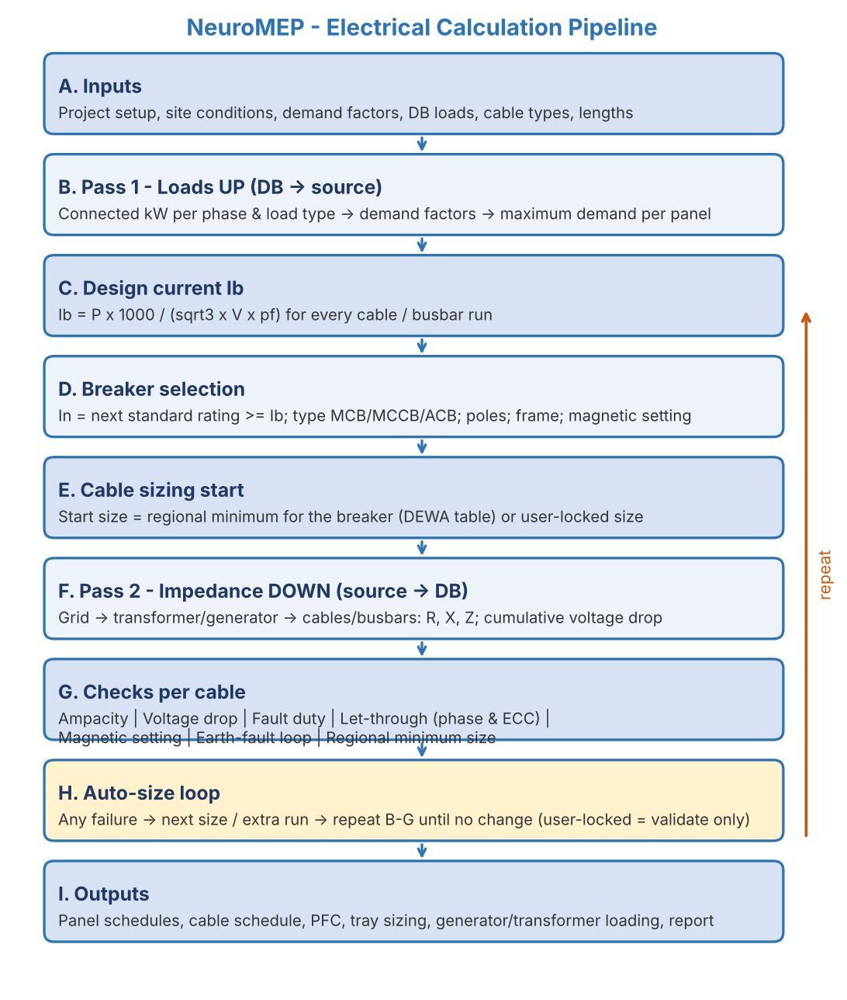

**Software Requirements & System Design Specification (SRS/SDD)**

**Project Name:** NeuroMEP - Connected MEP Design, Validation & Electrical Calculation Platform

**Release Covered:** Phase 1 - Electrical LV Distribution (Source to Distribution Board incoming feeder)

**Document Version:** v0.4 (Draft for Freeze) \| October 2026

**Prepared By:** NeuroMEP Development Team

**Target Environment:** Web application (browser-based, desktop screens); hosting target to be confirmed (OI-27)

**Document Status:** DRAFT - becomes the frozen baseline once every Blocking item in Section 15 is closed and Section 0 is signed.

# **0. Document Control & Sign-off**

## **Revision History**

| **Version** | **Date**    | **Author**       | **Change Summary**                                                                                                                                                                                                                                                                                                                                                        |
|-------------|-------------|------------------|---------------------------------------------------------------------------------------------------------------------------------------------------------------------------------------------------------------------------------------------------------------------------------------------------------------------------------------------------------------------------|
| v0.1        | 21-Oct-2026 | Development Team | Initial draft built from CableSizer v1.1 calculation file and user manual, Components for NeuroMEP workbook, Project Set-up (Electrical) inputs and current NeuroMEP UI screens.                                                                                                                                                                                          |
| v0.2        | 21-Oct-2026 | Development Team | Live in-canvas calculation: cable and breaker sizes calculated in the background on every edit and shown in the properties panel with Provisional / Final status and the deciding check ("Sized by"); Architecture page no longer runs a separate calculation; FR-10 expanded (re-calibration and alignment on plan replacement); new FR-47 to FR-50; Section 8.18 added. |
| v0.3        | 21-Oct-2026 | Development Team | Module E stated explicitly as a background service with no page; FR-51 added (set-up changes recalculate the whole project); architecture layer 04 description updated.                                                                                                                                                                                                   |
| v0.4        | 21-Oct-2026 | Development Team | Section 10.1 reduced to the Project Set-up slide inputs plus floor levels/heights; calculation defaults moved to new Section 10.1A (rule pack, not user-entered).                                                                                                                                                                                                         |
| v1.0        | TBD         |                  | Frozen baseline after closure of Blocking open items and sign-off.                                                                                                                                                                                                                                                                                                        |

## **Source Documents**

| **Ref** | **Document**                                                   | **Used For**                                                                                                           |
|---------|----------------------------------------------------------------|------------------------------------------------------------------------------------------------------------------------|
| SD-01   | Cablesizer_v1.1 - Calculation File (.xls), W S Atkins          | Calculation chain (cal sheet, ~6,100 formulas), panel schedule logic, all back-end lookup tables (34 macro functions). |
| SD-02   | CABLESIZER VERSION-1.1 USER MANUAL (35 pages)                  | Formulae, design standards (BS 7671 16th Ed., IEC 60781, IEC 60364), input/output conventions.                         |
| SD-03   | Componentes_for_NeuroMEP.xlsx                                  | Component property model, dropdown values, safety rules, output schedule formats (LV Panel/MDB/SMDB/ACB, Busbar, MCC). |
| SD-04   | Project Set-up - Electrical (slide)                            | First-page project inputs and calculation set-up.                                                                      |
| SD-05   | NeuroMEP UI screens (Login, Import Floor Plan, Floor Modeling) | Page structure, existing controls and component library.                                                               |

## **Approval for Freeze**

| **Role**                    | **Name** | **Responsibility in Sign-off**                    | **Signature / Date** |
|-----------------------------|----------|---------------------------------------------------|----------------------|
| Technical Lead (Electrical) |          | Scope, workflow and page behaviour                |                      |
| Senior Electrical Engineer  |          | Calculation method, limits, reference data values |                      |
| Development Lead            |          | Feasibility, architecture, estimates              |                      |
| Product Owner               |          | Priorities and acceptance criteria                |                      |

**Freeze criteria:** (1) all items marked Blocking in Section 15 are answered; (2) a hand-checked reference project is received for acceptance testing (OI-04); (3) all four roles above have signed. Any change after freeze follows a change request with impact assessment.

# **1. Project Overview & Objectives**

**NeuroMEP** is a web application for MEP (Mechanical, Electrical, Plumbing/PHE) design engineers. Today engineers receive architectural floor plans, manually draw MEP components on them, and size every cable and breaker in spreadsheets such as CableSizer. NeuroMEP replaces this with one connected model: the engineer imports the floor-plan PDFs, drags components from a library onto each floor, connects them by drawing cables (in the style of Cisco Packet Tracer), and the application performs every electrical calculation, sizes and validates each breaker and cable from the supply down to the distribution boards, and produces the fixed-format schedules that contractors build from.

**Phase 1** covers the electrical LV distribution network from the incoming supply (EB utility / RMU, transformer, standby generator, UPS) through the main LV panel / MDB, busbar risers, SMDBs and MCCs, down to the incoming feeder of each Distribution Board (DB). Calculations inside the DB, final circuits, and mechanical / PHE engineering calculations are later phases.

## **Core Objectives**

- **Eliminate Manual Calculation:** Every load summation, current, breaker, cable, voltage-drop, fault-level and earth-fault calculation is performed automatically from the drawn model.

- **Precision & Compliance:** Results follow the adopted design standard and the regional authority rules (Dubai / DEWA in v1) using versioned reference tables, with no hand-entered intermediate values.

- **Upstream-Downstream Consistency:** Any change anywhere in the network (a load, a length, a cable) recalculates every affected element above and below it.

- **Auto-Sizing:** The smallest breaker and cable that pass all checks are proposed automatically; the engineer may lock a choice, which is then validated rather than changed.

- **Safety Rule Enforcement:** Fire & life-safety (FLS), essential and critical loads are checked for correct back-up sources and fire-rated cabling along their entire supply path.

- **Fixed-Format Deliverables:** Panel schedules, cable schedules and calculation reports are generated in agreed templates, ready to issue at each design stage.

- **Traceability:** Every calculated value can be opened to show its inputs, the table values used and the formula applied.

# **2. User Roles & Access Control**

| **Role**                       | **Access Level**                                         | **Primary Responsibilities**                                                                                                          |
|--------------------------------|----------------------------------------------------------|---------------------------------------------------------------------------------------------------------------------------------------|
| Technical Lead / Project Admin | Full project access, all disciplines                     | Creates the project, completes Project Set-up, assigns discipline engineers, approves issue at each design stage.                     |
| Electrical Engineer            | Edit - Electrical layer                                  | Places electrical components, draws connections, enters DB loads, reviews results, locks/overrides sizes, exports schedules.          |
| Mechanical Engineer            | Edit - Mechanical layer (Phase 2); Phase 1 data provider | In Phase 1 supplies electrical data (kW, phases, power factor, load category) for mechanical equipment fed by the electrical network. |
| PHE Engineer                   | Edit - PHE layer (Phase 2); Phase 1 data provider        | As above for pumps, fire pumps and other PHE equipment.                                                                               |
| Checker / Reviewer             | Read + comment                                           | Verifies results ("Checked by" in title blocks) and signs off revisions.                                                              |
| System Administrator           | Reference data & users                                   | Maintains region rule packs, lookup tables, breaker catalogue, demand-factor defaults and user accounts.                              |

- **Discipline locks:** each discipline layer is editable only by its assigned engineers; other layers are shown read-only (the existing "MECH Locked" / "PHE Locked" indicators).

- **Authentication:** company login; integration with the MAEC One unified login and role model to be confirmed (OI-28).

# **3. Scope & Electrical Hierarchy**

An electrical distribution network is a tree. Power enters at one root and branches until it reaches every board. Every branch is a cable or busbar with a circuit breaker at its upstream end. Phase 1 models the tree down to the DB, which is treated as an end point whose load is entered by the engineer.

| **Level**                   | **Typical Equipment**                                  | **Fed From**                  | **Feeds**                                        |
|-----------------------------|--------------------------------------------------------|-------------------------------|--------------------------------------------------|
| L0 - Supply                 | EB Utility / RMU (HV)                                  | Grid (fault level input)      | Transformer                                      |
| L1 - Source                 | Transformer; Generator (via ATS); UPS (critical loads) | RMU / ATS / panel             | LV Panel / MDB / ACB panel                       |
| L2 - Main distribution      | LV Panel, MDB, ACB panel, ESMDB                        | Transformer / Generator / ATS | Busbars, SMDBs, MCCs, PFC bank, isolators, DBs   |
| L3 - Riser                  | Busbar (feeder or tap-off type) with tap-off boxes     | MDB                           | SMDBs, DBs (via tap-off boxes)                   |
| L4 - Sub-main               | SMDB, ESMDB, MCC, EMCC                                 | MDB / busbar tap-off          | DBs, isolators, motors                           |
| L5 - Terminal (Phase 1 end) | DB, isolator, connection unit                          | SMDB / MCC / MDB              | Not modelled in Phase 1 (load entered as totals) |

## **In Scope (Phase 1)**

- Project set-up, floor registry and floor-plan import with scale calibration.

- Floor and building modelling of electrical distribution equipment and their interconnections.

- Full LV calculation chain: load aggregation with demand factors, design current, breaker selection, cable ampacity with derating, voltage drop, short-circuit, let-through energy, earth-fault loop impedance, regional minimum sizes.

- Automatic sizing with user locks; normal and standby (generator) supply scenarios.

- Ancillary sizing: power-factor correction bank, cable tray width, generator/UPS rating, transformer loading.

- Generation of panel schedules (MDB/SMDB/ACB, Busbar, MCC), cable schedule, calculation report and single-line diagram.

Out-of-scope items are listed in Section 14.

# **4. Functional Requirements**

## **Module A: Project Set-up**

- **FR-01 (Priority: High):** The application shall capture the project fields defined in Section 10.1 and block progress until all mandatory fields are valid.

- **FR-02 (Priority: High):** Selecting a Region shall load that region's rule pack (reference tables, voltage-drop limits, minimum cable sizes, demand-factor defaults). Only "Dubai" is active in v1; other regions are shown as unavailable until their rule packs exist.

- **FR-03 (Priority: High):** Demand-factor tables (12 load types; category factors Residential / Landlord / Office / Retail) shall be pre-filled from the rule pack, editable per project, and overridable per panel. Every change shall be logged.

- **FR-04 (Priority: High):** Calculation check-boxes (Current Carrying Capacity, Voltage Drop, Short-circuit, Let-through Energy, Earth Fault Loop Impedance) shall control which checks are enforced. Disabled checks are still computed and reported as "Not verified" in all outputs.

- **FR-05 (Priority: High):** The floor registry shall be generated from the floor counts (basements, GF, podiums, typical floors, mechanical floors). Each floor requires a level reference, finished floor level and floor-to-floor height.

- **FR-06 (Priority: Medium):** Plot load allocation shall accept kW or kVA; conversion uses the project default power factor.

- **FR-07 (Priority: High):** Design stage (CD, SD, DD, TD, IFC) and revision shall appear in every export title block and file name.

## **Module B: Floor-Plan Import**

- **FR-08 (Priority: High):** The engineer shall upload one PDF plan per floor; the viewer shall render vector PDFs with zoom and pan.

- **FR-09 (Priority: High):** Each floor shall be scale-calibrated (pick two points and enter the real distance, or enter the drawing scale). Cable lengths shall not be calculated on an uncalibrated floor.

- **FR-10 (Priority: Medium):** Replacing a floor plan shall keep the existing model, require re-calibration and alignment of the new plan to the previous one using a common reference point (for example a grid-line intersection), recalculate all cable lengths on that floor, and flag components that fall outside the new drawing extents for the engineer's review.

## **Module C: Floor Modelling**

- **FR-11 (Priority: High):** A bottom component library with tabs All / Electrical / Mechanical / PHE shall offer only the components the user's discipline permits.

- **FR-12 (Priority: High):** Components shall be placed by drag-and-drop and receive an automatic equipment tag following Section 9.3.

- **FR-13 (Priority: High):** Cables shall be drawn port-to-port with orthogonal multi-point routing. Length = routed plan length x floor scale + vertical allowances + length allowance (OI-17).

- **FR-14 (Priority: High):** Connections shall be validated against the topology rules (Section 9.2); illegal connections are refused with an explanatory message.

- **FR-15 (Priority: High):** Drawing a cable out of a panel creates an outgoing way (breaker slot) with an automatic circuit reference (1RYB, 2R, 3Y ...). A warning appears above 18 outgoing ways and the maximum is 25.

- **FR-16 (Priority: High):** Cable construction properties (conductor, cores, insulation, armour, sheath, installation method, grouping) default from the project and may be changed when drawing. Cable size, number of runs, earth conductor and breaker rating are calculated automatically the moment the cable is drawn and are shown in the properties panel (Section 8.18); the engineer does not pick them.

- **FR-17 (Priority: High):** Each DB shall accept its load either as connected kW per phase (R/Y/B) by load type, or as floor area x W/m2 per phase, together with load category, demand category and power factor.

- **FR-18 (Priority: High):** Selecting any component or cable shall show its properties and live calculation results in the right-hand properties panel (Section 8.18), together with a project summary of connected and maximum-demand load against the plot load allocation and transformer capacity (% loaded).

- **FR-19 (Priority: Medium):** Markup shall be saveable/loadable per floor, independent of the project file.

## **Module D: Building Modelling**

- **FR-20 (Priority: High):** Floors shall be stacked by elevation into a 3D isometric view with discipline colouring for visual validation.

- **FR-21 (Priority: High):** Vertical risers (busbar or cable) shall be defined by shaft position and the floors they serve; riser and tap-off lengths are calculated from floor elevations.

- **FR-22 (Priority: High):** Floor boards shall be connected to riser tap-offs, risers to the MDB, the MDB to its transformer, and the generator through an ATS (normal + standby inputs).

- **FR-23 (Priority: High):** The network shall be validated as complete: every element traces to a source, the network is radial (no loops), and each element has exactly one active supply per scenario.

## **Module E: Calculation Engine (background service - no page of its own)**

Unlike Modules A-D, Module E has no screen. It is a background service that recalculates automatically whenever any of its inputs change - project set-up values (Page 1), components, cables and loads (Page 2), building connections (Page 3) or overrides and locks (Page 4) - and publishes its results to the properties panel, status colours, single-line diagram, schedule grid and exports of the other pages.

- **FR-51 (Priority: High):** The calculation engine shall have no user interface of its own and no manual run step. A change to any project set-up value (ambient or soil temperature, soil resistivity, upstream fault level, demand factors, region, enabled checks) shall recalculate the whole project; a change to the model shall recalculate the affected part of the network.

- **FR-24 (Priority: High):** Loads shall be aggregated bottom-up per phase and per load type with demand factors to give the maximum demand at every panel and source (Section 8.3).

- **FR-25 (Priority: High):** Design current Ib shall be calculated for every cable and busbar run from the maximum demand it carries (Section 8.4).

- **FR-26 (Priority: High):** Protective devices shall be selected automatically: rating, frame, type (MCB/MCCB/ACB), poles, magnetic setting and breaking capacity (Section 8.5).

- **FR-27 (Priority: High):** Cable current-carrying capacity shall be derated for ambient/soil temperature, grouping, soil thermal resistivity and depth of laying (Section 8.7).

- **FR-28 (Priority: High):** Voltage drop shall be calculated per cable and accumulated from the source; limits are applied per level (Section 8.8).

- **FR-29 (Priority: High):** Prospective three-phase short-circuit current shall be calculated at every node, including transformer, generator, busbar, cable and motor contributions (Section 8.9).

- **FR-30 (Priority: High):** Thermal withstand (let-through energy) shall be checked for phase conductors and earth conductors (Section 8.10).

- **FR-31 (Priority: High):** Earth-fault loop impedance shall be calculated at 20 C and at fault temperature and compared with the protective device limit (Section 8.11).

- **FR-32 (Priority: High):** The regional minimum cable size for the breaker rating (DEWA table in v1) shall be enforced (Section 8.12).

- **FR-33 (Priority: High):** An auto-sizing loop shall upsize cables (size, then parallel runs) until all checks pass or a limit is reached; user-locked items are validated only (Section 8.13).

- **FR-34 (Priority: High):** Calculations shall run for the Normal (transformer) and Standby (generator) scenarios; fire-mode demand shall be reported for generator sizing (Section 8.14).

- **FR-35 (Priority: High):** Safety rules: essential and FLS loads must trace to a generator; critical loads to a UPS and a generator; FLS loads default to fire-rated cable and every cable on their path to the generator must be fire-rated (Section 8.16).

- **FR-36 (Priority: Medium):** PFC bank, cable tray width, generator/UPS rating and transformer loading shall be calculated (Section 8.15).

- **FR-37 (Priority: High):** Calculations shall run continuously in the background: every model change (component added or removed, cable drawn or re-routed, load or property edited, upstream or downstream path extended) shall recalculate the affected network without any separate calculate step. Unlocked cables and breakers are re-solved from their minimum size on every run, so sizes move up or down to match the current model. Each element shows OK / Warning / Fail / Not verified.

- **FR-38 (Priority: High):** All failing checks for an element shall be reported (not only the first), each with a plain-language message and suggested action.

- **FR-39 (Priority: High):** Every calculated value shall be traceable: inputs, reference-table values (with table name and version) and formula.

- **FR-47 (Priority: High):** Every cable and breaker shall display a Provisional or Final status. Provisional applies while the element has no complete path to a source or has no load entered; provisional results use the stated assumptions of Section 8.18 and are labelled as such in the panel, schedules and exports.

- **FR-48 (Priority: High):** For every auto-sized cable and breaker the panel shall show the deciding check ("Sized by": current-carrying capacity, voltage drop, let-through energy, earth-fault loop or regional minimum) so the engineer can see why the size was chosen.

- **FR-49 (Priority: High):** The engineer may lock a cable size, number of runs or breaker rating from the properties panel; locked values are never changed by the engine and are validated with all checks on every recalculation.

- **FR-50 (Priority: High):** Background calculation shall not block drawing: it runs separately from the canvas, starts shortly after the user stops editing, and updates the properties panel and status colours without interrupting the user.

## **Module F: Schedules, Reports & Export**

- **FR-40 (Priority: High):** Panel schedules shall be generated automatically in the fixed formats of Section 11; the engineer never uploads a schedule.

- **FR-41 (Priority: High):** In the schedule grid only user-input cells are editable; all other cells are locked. Edits in the grid and on the canvas stay synchronised.

- **FR-42 (Priority: High):** Exports: panel schedules, cable schedule, PFC sheet, tray sizing and calculation report in Excel and PDF; single-line diagram in PDF (DXF to be confirmed, OI-25).

- **FR-43 (Priority: High):** Export files shall never overwrite existing files; an incremental suffix (\_v1, \_v2 ...) is appended on collision.

## **Module G: Reference Data & Project Persistence**

- **FR-44 (Priority: High):** Reference data shall be held in versioned rule packs editable by the System Administrator with an audit log. A project records the rule-pack version it was calculated with.

- **FR-45 (Priority: High):** Lookups for values between table steps (for example 28 C soil, 1.2 K.m/W) shall follow the rule agreed in OI-06; a lookup shall never silently return "no derating".

- **FR-46 (Priority: High):** Projects shall be saved and re-opened as a project file (.json) and in the database, with autosave and undo/redo.

# **5. Non-Functional Requirements (NFRs)**

- **Performance:** Properties panel and status colours updated within 0.5 seconds of an edit; full recalculation of a building network of up to 2,000 elements within 1 second.

- **Canvas Responsiveness:** Smooth zoom/pan with up to 1,000 objects per floor on plans up to A0 size.

- **Calculation Accuracy:** Continuous results (currents, impedances, voltage drop, fault levels) within +/-0.5% of the hand-checked reference project; discrete selections (cable size, runs, breaker rating) identical.

- **Determinism:** The same model and rule-pack version always produce identical results.

- **Traceability & Audit:** Every result explainable from inputs; all reference-data and demand-factor changes logged with user and time.

- **Data Integrity:** Reference data versioned; a project re-opened later recalculates with its recorded rule-pack version unless the user upgrades explicitly.

- **Usability:** Plain-language messages; colour coding always paired with a text label; usable by an electrical engineer after a short walkthrough.

- **Reliability:** Autosave at a fixed interval and on page change; no loss of more than one minute of work on browser failure.

- **Security:** Role-based access per project and discipline; project data stays on company-controlled infrastructure.

- **Compatibility:** Latest Chrome and Edge; minimum screen 1920 x 1080.

- **Maintainability:** Calculation engine delivered as an isolated, fully unit-tested module, independent of the user interface.

- **Extensibility:** New regions, components and disciplines added through rule packs and component definitions without changing the engine core.

# **6. System Architecture Reference**

The application is organised into six layers. User actions flow down from the interface to the model; results flow back up. The calculation engine never reads the interface directly: it receives the network model and a rule-pack version and returns results, which keeps it independently testable.

| **Layer**                   | **Component**                                   | **Responsibility**                                                                                                                                                                    |
|-----------------------------|-------------------------------------------------|---------------------------------------------------------------------------------------------------------------------------------------------------------------------------------------|
| 01 - Presentation           | Web UI pages                                    | Login, Project Set-up, Floor Modelling canvas, Building Modelling 3D view, Architecture (SLD + schedule grid), Simulation & Report.                                                   |
| 02 - Application Controller | Project state service                           | Discipline locks, undo/redo, autosave, change detection that triggers recalculation, routing of results and warnings to the UI.                                                       |
| 03 - Network Model          | Graph model                                     | Nodes (sources, panels, busbars, tap-offs, DB end-points) and edges (cables, busbar runs); topology rules; tagging; lengths from scale and elevations.                                |
| 04 - Calculation Engine     | Electrical engine (background service, no page) | Runs automatically on every input change. Load aggregation, Ib, breaker selection, ampacity, voltage drop, short-circuit, let-through, earth-fault loop, auto-sizing loop, scenarios. |
| 05 - Reference Data         | Rule-pack service                               | Versioned regional tables: cable ampacity, derating, R/X, voltage drop, ECC, armour, busbar, transformer, breaker catalogue, demand factors, limits.                                  |
| 06 - Persistence & Export   | Storage & export service                        | Project file and database, output versioning, Excel/PDF schedule and report generation, SLD export.                                                                                   |

# **7. Implementation & Execution Workflow**

The application has a login screen followed by five working pages, shown as the left-hand navigation. Each page has entry and exit conditions so that later pages always receive complete data.

| **Page** | **Name**                           | **Purpose**                                               | **Main Outputs**                                              |
|----------|------------------------------------|-----------------------------------------------------------|---------------------------------------------------------------|
| 0        | Login                              | Authenticate the engineer                                 | User session and role                                         |
| 1        | Project Set-up & Import Floor Plan | Project data, calculation set-up, floors, plans, scale    | Project record, floor registry, calibrated plans              |
| 2        | Floor Modelling                    | Place components, draw connections; sizes calculated live | Floor network, cable lengths, DB loads, live sizes and checks |
| 3        | Building Modelling                 | Stack floors, define risers, connect to sources           | Complete building network                                     |
| 4        | Architecture                       | Single-line diagram, schedule review, locks and overrides | Reviewed network, schedules                                   |
| 5        | Simulation & Report                | Scenario runs, final checks, exports                      | Issued schedules, reports, SLD                                |

## **Page 1 - Project Set-up & Import Floor Plan**

**1. Project Details**

The Technical Lead enters project name, location, design stage, revision, client, plot reference, project category, plot load allocation and site conditions (ambient air temperature, soil temperature, soil thermal resistivity, altitude). Field definitions are in Section 10.1.

**2. Calculation Set-up**

Region is selected (loads the rule pack), the upstream short-circuit capacity is entered (for example 350 MVA), the calculation checks are ticked, and the demand-factor tables are reviewed - pre-filled from the region defaults and editable.

**3. Floors & Elevations**

Floor counts generate the floor registry (B1..Bn, GF, P1..Pn, typical floors, mechanical floors 1-3). For each floor the finished floor level and floor-to-floor height are entered; these produce riser lengths later.

**4. Working Directory & Discipline Assignment**

The working directory is set and engineers are assigned for Electrical, Mechanical and PHE; this drives discipline locks.

**5. Floor-Plan Upload & Scale Calibration**

A PDF plan is uploaded for each floor in the registry and calibrated. A previously saved project (.json) can be imported instead. Exit condition: mandatory fields valid; every floor to be modelled has a calibrated plan.

## **Page 2 - Floor Modelling**

**1. Place Components**

The engineer drags SMDBs, DBs, MCCs, isolators and other components from the bottom library onto the plan. Each receives an automatic tag and opens its property panel on the right.

**2. Draw Connections**

The engineer draws a cable from the source panel to the target. Routing is orthogonal with multiple bend points; the length is calculated from the calibrated scale. The source panel gains an outgoing way.

**3. Set Cable Construction**

Conductor, cores, insulation, armour, sheath, installation method and grouping are confirmed (project defaults apply). FLS loads default to fire-rated cable. The engineer does not choose the size.

**4. Enter DB Loads**

For each DB the connected load is entered per phase and load type (or area x W/m2), with load category, demand category and power factor.

**5. Live Calculation & Properties Panel**

As soon as a cable is drawn the engine calculates its current, breaker, cross-sectional area, runs, earth conductor, voltage drop and fault values in the background and shows them in the right-hand panel, with Provisional / Final status and the deciding check. Adding loads, extending the path upstream or downstream, or editing any property re-sizes affected cables up or down automatically.

**6. Save**

Markup and project are saved. Exit condition: no unconnected components and no rule violations on the floor.

## **Page 3 - Building Modelling**

**1. Stack Floors**

Floors are stacked by elevation into a 3D isometric view with discipline colours for visual validation.

**2. Define Risers**

Busbar or cable risers are placed in their shafts; tap-off positions are defined per floor; lengths come from floor elevations.

**3. Connect to Sources**

Floor boards connect to riser tap-offs; risers to the MDB; the MDB to the transformer; the generator through the ATS; UPS for critical loads; PFC bank on the MDB. As each connection completes a path to a source, the affected cables change from Provisional to Final and are re-sized with real fault levels and cumulative voltage drop.

**4. Network Validation**

The network is checked for completeness, radial structure, single active source per scenario and safety-category source requirements. Exit condition: validation passes.

## **Page 4 - Architecture**

**1. Generate Single-Line Diagram**

The model is drawn as a single-line diagram (tree from source to DBs).

**2. Review Calculated Network**

No separate calculation is run - results are already current from the live engine. Elements still Provisional are listed with the reason (no source path, no load).

**3. Review Results**

Each cable and panel shows OK / Warning / Fail / Not verified. Clicking an element opens its calculation trace.

**4. Review Schedules**

Panel schedules are shown in grid form in the output formats of Section 11. Only input cells (tags, locations, meters, remarks, ELCB choice, starter type, manual loads) are editable.

**5. Override & Lock**

The engineer may override and lock a cable size, number of runs or breaker; adjust demand factors per panel; and assign single-phase loads to phases. The engine re-runs and validates locked items without changing them.

## **Page 5 - Simulation & Report**

**1. Scenario Runs**

Normal (transformer) and Standby (generator: power-failure and fire-mode demand) are run and compared.

**2. Final Check List**

Outstanding warnings, failures, "Not verified" checks and user overrides are listed for sign-off.

**3. Export**

Panel schedules, cable schedule, PFC sheet, tray sizing, calculation report and SLD are exported with title blocks (design stage, revision, prepared/checked by) and versioned file names.

# **8. Electrical Calculation Specification**

This section is the authoritative definition of the calculation engine. It reproduces the CableSizer v1.1 method (SD-01, SD-02) with the corrections listed in Appendix E. Symbols follow the CableSizer manual.

## **8.1 Conventions**

| **Quantity**                                   | **Symbol**     | **Unit**                                                                  | **Display Rounding** |
|------------------------------------------------|----------------|---------------------------------------------------------------------------|----------------------|
| Nominal voltage                                | Vn             | V (400 three-phase / 230 single-phase; 380/220 where the supply is 380 V) | Integer              |
| Active power / apparent power / reactive power | P / S / Q      | kW / kVA / kVAr                                                           | 1 decimal            |
| Current                                        | Ib, In, Iz, Im | A                                                                         | 1 decimal            |
| Impedance, resistance, reactance               | Z, R, X        | milliohm (mOhm); per-metre values in mOhm/m                               | 3 decimals           |
| Prospective fault current                      | Isc, Ief       | kA                                                                        | 2 decimals           |
| Voltage drop                                   | Vc, Vt         | V and % of Vn                                                             | 2 decimals           |
| Cross-section                                  | S, A           | mm2                                                                       | Standard size        |
| Length                                         | L              | m                                                                         | 1 decimal            |
| Temperature / soil thermal resistivity         | \-             | deg C / K.m/W (deg C.m/W)                                                 | 1 decimal            |

Internal calculations use full floating-point precision; rounding is applied only for display and export.

## **8.2 Calculation Order**

This sequence runs automatically in the background after every model change (Section 8.18).

1.  Identify supply paths; elements without a complete path to a source are calculated in Provisional mode (Section 8.18).

2.  Pass 1 (bottom-up): aggregate connected load per phase and load type; apply demand factors; obtain maximum demand per panel and source.

3.  Calculate Ib for every cable/busbar run; select breakers.

4.  Assign starting cable size: user-locked size, else the regional minimum for the breaker rating.

5.  Pass 2 (top-down): accumulate R and X from the upstream network; calculate Isc, cumulative voltage drop and earth-fault loop impedance at every node.

6.  Evaluate all checks for every cable; upsize failing cables; repeat from step 3 until no change (Section 8.13).

7.  Run the standby scenario; calculate ancillary outputs; produce results and schedules.

## **8.3 Load Aggregation & Demand Factors**

- **DB (terminal):** connected load C(type, phase) entered by the engineer, or C = area x W/m2 per phase.

- **Panel:** C_panel(type, phase) = sum of C of all downstream elements; Demand(type, phase) = C_panel(type, phase) x DF(type) \[x category factor, OI-02\]; Maximum Demand MD = sum of Demand over all types.

- **Source:** transformer MD = MD of the panels it feeds; generator MD calculated separately for power-failure mode (normal + essential + critical + FLS loads it backs up, as agreed in OI-11) and fire mode (FLS loads).

- **Open decision (OI-02):** CableSizer applies demand factors at every panel to the sum of downstream connected loads; whether factors compound across levels or apply once must be confirmed.

## **8.4 Design Current Ib**

| **Case**                      | **Formula (P in kW, Q in kVAr, V in volts)**                                                 |
|-------------------------------|----------------------------------------------------------------------------------------------|
| Three-phase load              | Ib = P x 1000 / (sqrt(3) x V x pf)                                                           |
| Single-phase load             | Ib = P x 1000 / (V x pf)                                                                     |
| Two-phase load (legacy)       | Ib = P x 1000 / (2 x V x pf) x 1.732 - confirm (OI-23)                                       |
| Motor with star-delta starter | Ib = P x 1000 / (3 x V x pf) per cable set; two cable sets are installed                     |
| Capacitor (PFC) bank          | Ib = Q x 1000 / (sqrt(3) x V); CableSizer additionally divides by sin(phi) - confirm (OI-23) |
| Panel / busbar feeder         | Ib from the maximum demand of the downstream panel and its power factor                      |

## **8.5 Protective Device Selection**

- **Rating In:** lowest standard rating \>= Ib (Appendix C); user may lock a higher value.

- **Frame:** lowest frame \>= In from 100, 160, 250, 400, 630, 800, 1000, 1250, 1600, 2000, 2500, 3200, 4000, 6300 A.

- **Type:** MCB / MCCB below 800 A; ACB automatically at 800 A and above; MCP for motor circuits.

- **Poles:** 1P for single-phase, 3P (TP) for three-phase loads, 4P for sources (transformer, generator, UPS) and main incomers.

- **Magnetic threshold Im:** Im = n x frame for thermal-magnetic frames up to 250 A (fixed threshold); Im = n x In above 250 A (adjustable); n default 10.

- **Breaking capacity:** lowest catalogue value \>= Isc at the panel where the breaker is installed (catalogue values, OI-03). CableSizer used fixed 50 kA (MDB/SMDB/MCC) and 35 kA (others); this is replaced.

- **Earth leakage:** 30 mA ELCB, 100 mA ELCB, 0-300 mA ELS or 0-500 mA ELS; acquired from the downstream isolator/load or selected; displayed in the Remarks column.

## **8.6 Cable Construction Defaults**

- **Cores:** single-phase feeders 3C; main transformer-to-MDB feeders 1C; motors 3C; other three-phase feeders 4C; user may change.

- **Armour:** single-core cables only AWA; multicore XLPE cables SWA; unarmoured where selected.

- **Sheath:** PVC or LSZH; **voltage grade:** 450/750 V (single-core wires), 300/500 V (3-core flexible), 600/1000 V (single or multicore cables).

- **Earth conductor (ECC):** sized from the phase size, conductor material and insulation using the CPC table; above 600 mm2 total the ECC becomes 2 x 150 mm2.

- **Size range:** 1.5 - 630 mm2; multicore up to 300 mm2; larger loads use parallel runs (maximum runs OI-21).

## **8.7 Current-Carrying Capacity (Check 1)**

| **Factor**                    | **Applies To** | **Lookup Keys**                                                                                                             | **Reference Table**      |
|-------------------------------|----------------|-----------------------------------------------------------------------------------------------------------------------------|--------------------------|
| It - nominal rating           | All cables     | Material, phases, cores, installation method, insulation, size                                                              | NOMRATCU / NOMRATAL      |
| K1 - temperature              | All cables     | Method, insulation, temperature (air for B/J, soil for D)                                                                   | TEMPDE                   |
| K2 - grouping                 | All cables     | B: no. of circuits; J: cores, circuits, spacing (touching / D / 2D), no. of trays; D: cores, direct/duct, circuits, spacing | GROUPB / GROUPJ / GROUPD |
| Kr - soil thermal resistivity | Buried (D)     | Direct/duct, cores, size, resistivity                                                                                       | STR                      |
| K3 - depth of laying          | Buried (D)     | Direct/duct, cores, size, depth                                                                                             | DLAY                     |

**Ktot** = K1 x K2 (in air) or K1 x K2 x Kr x K3 (buried). **Iz** = It x Ktot x number of runs. **Pass condition:** Iz \>= In. Installation methods: B = conduit/trunking, J = tray/trench, D = direct buried or duct.

## **8.8 Voltage Drop (Check 2)**

- **Unit drop:** Vu = VDr x cos(phi) + VDx x sin(phi) mV/A/m for XLPE cables above 16 mm2 (tables RESIS/REACT); otherwise the tabulated unit drop VU(size, insulation, phases); busbars use Vubd(rating).

- **Circuit drop:** Vc = Ib x L x Vu / (runs x 1000) V; **cumulative:** Vt = Vc + Vt(upstream); **%Vt** = Vt / Vn x 100.

- Spare ways and control circuits are excluded.

| **Network Point (cumulative from source)** | **Maximum Total Voltage Drop - Dubai rule pack** |
|--------------------------------------------|--------------------------------------------------|
| MDB                                        | 2.0 %                                            |
| SMDB                                       | 2.0 %                                            |
| Busduct                                    | 2.0 %                                            |
| MCC                                        | 2.0 %                                            |
| DB                                         | 2.5 %                                            |
| Motor loads                                | 4.0 %                                            |
| Final circuits (future phase)              | 4.0 %                                            |

## **8.9 Short-Circuit Current (Check 3)**

| **Element**              | **Resistance R (mOhm)**                                     | **Reactance X (mOhm)**                                                                                   |
|--------------------------|-------------------------------------------------------------|----------------------------------------------------------------------------------------------------------|
| Upstream network         | R = 0.1 x X                                                 | Z = Vn^2 / (Sup x 1000) with Sup in MVA; X = 0.995 x Z                                                   |
| Transformer              | R = Ur x Vn^2 / (S x 100)                                   | X = Ux x Vn^2 / (S x 100); Ux = sqrt(Uz^2 - Ur^2); Uz, Ur from datasheet, else Appendix C defaults       |
| Generator                | R = 0.1 x X                                                 | X = X"d x Vn^2 / (S x 100); X"d default 14 %                                                             |
| Cable                    | R = rho x L / (A x N); rho = 18.32 (Cu), 30.34 (Al) at 20 C | X = 0.1 x L / N (A \< 120 mm2); 0.09 x L / N (A \>= 120 mm2)                                             |
| Busbar                   | R = Rbd(rating) x L                                         | X = Xbd(rating) x L                                                                                      |
| Motor group (main panel) | R'm = 0.42 x Z'm                                            | X'm = 0.91 x Z'm; Z'm = Vn^2 / (Sm x IL/IF); combined in parallel with the network by adding admittances |

**Accumulation:** Rkt = sum of R from the source to the point; Xkt likewise; Zkt = sqrt(Rkt^2 + Xkt^2). **Isc** = c x Vn / (sqrt(3) x Zkt) kA with c = 1.0 for 230/400 V. **Pass condition:** breaking capacity of each breaker \>= Isc at the panel where it is installed. The main panel is calculated with and without motor contribution and the higher value is used downstream.

## **8.10 Let-through Energy / Thermal Withstand (Check 4)**

- **Phase conductor:** S1 = Isc x 1000 x sqrt(t1) / k1 must not exceed installed area (size x runs).

- **Earth conductor:** S2 = Ief x 1000 x sqrt(t2) / k2 must not exceed installed ECC area.

- **k factors:** Cu/XLPE 143; Cu/PVC 115 (\<= 300 mm2), 103 (\> 300 mm2); Al/XLPE 94; Al/PVC 76 (\<= 300 mm2), 68 (\> 300 mm2); bare Cu 115/103; bare Al 76/68.

- **Disconnection time t:** 0.05 s default (CableSizer value); to be confirmed or taken from the trip-curve table (OI-12).

## **8.11 Earth-Fault Loop Impedance (Check 5)**

- **Per-metre values (20 C):** Rc = rho / (A x N); Recc = rho / (Aecc x Necc); Ra = armour resistance table / N (single-core AWA bonded: table value / 3); Rp = Recc x Ra / (Recc + Ra); reactance Xc+Xp = 0.3 mOhm/m for multicore armoured cables, average of conductor and ECC values for single-core, Xbd for busbars.

- **Loop:** Zu = sqrt((Rc + Rp)^2 + (Xc + Xp)^2); Zc = Zu x L; Zt = Zc + Zup (upstream loop impedance); Ief = (Vn / sqrt(3)) / Zt kA.

- **At fault temperature:** resistances multiplied by 1.38 (PVC) or 1.60 (XLPE); armour by 1.19 (PVC) or 1.28 (XLPE), with an extra 1.1 for steel wire armour; reactance unchanged; gives Z't.

- **Limit:** Zm = (Vn / sqrt(3)) / Im x 1000 mOhm. **Pass condition:** Z't \<= Zm.

- **Magnetic setting check:** Im must be below both Isc and Ief at the load end, so the breaker trips instantaneously for both fault types.

## **8.12 Regional Minimum Cable Size (Check 6)**

For the Dubai rule pack the installed size x runs must be at least the DEWA minimum for the breaker rating (Appendix D). This is the starting size of the auto-sizing loop.

## **8.13 Auto-Sizing Algorithm**

1.  Start every unlocked cable at the regional minimum for its breaker rating.

2.  Run Pass 2 and evaluate Checks 1-6 for every cable.

3.  For each failing unlocked cable: move to the next standard size; when the maximum size for the construction is reached, add a parallel run and restart from the smallest size meeting the regional minimum per run.

4.  If a breaker fails its breaking-capacity check, raise its breaking capacity (the cable is not changed for this reason).

5.  Repeat from step 2 until no element changes (upsizing only lowers impedance, so the loop converges); stop after 50 iterations and report non-convergence.

6.  Locked cables and breakers are never changed; their failures are reported to the engineer.

## **8.14 Supply Scenarios**

| **Scenario**            | **Source**        | **Loads Included**                    | **Used For**                                                                                  |
|-------------------------|-------------------|---------------------------------------|-----------------------------------------------------------------------------------------------|
| Normal                  | Transformer(s)    | All loads                             | Maximum fault levels (breaker duty, let-through); voltage drop; earth-fault loop              |
| Standby - power failure | Generator via ATS | Loads backed by the generator (OI-11) | Generator rating; voltage drop and earth-fault loop on generator supply (lower fault current) |
| Standby - fire mode     | Generator         | FLS loads (and others per OI-11)      | Generator rating; FLS circuit checks                                                          |

## **8.15 Ancillary Calculations**

- **PFC bank:** kVAr = sum over load types of Demand(type) x \[tan(acos(pf_load)) - tan(acos(pf_target))\]; pf_target default 0.92; default load pf: lighting 0.85, sockets 0.80, HVAC 0.80, water heater 1.00, laundry 0.85, kitchen 0.85, special equipment 0.80, spare 0.80 (hand dryer, pumps, fire pumps, lifts - OI-20); rating selected from the standard bank list (OI-20).

- **Transformer loading:** % = MD (kVA) / rating x 100; warning above the agreed limit (OI-16); total MD compared with plot load allocation.

- **Generator / UPS rating:** kVA = MD / 0.8, rounded up to the next standard size (OI-10); full-load current and fault duty reported.

- **Cable tray width:** per cable width = overall diameter x runs (single-core: (runs x 3 + neutral runs) x diameter x 2/3); total + 50 % spare; tray selected from 100, 150, 200, 300, 450, 600, 750, 900, 1000 mm.

## **8.16 Safety-Category Rules**

- Load categories: normal, essential, critical, FLS.

- Essential and FLS loads: the supply path must include a generator (through an ATS). Critical loads: the path must include a UPS and a generator.

- FLS loads: cable insulation defaults to fire-rated; selecting another type raises a warning but is allowed.

- When an element is fire-rated, every cable on its path back to the generator must be fire-rated; a busbar becomes fire-rated by default if any downstream load is FLS.

## **8.17 Check Results & Messages**

| **Code** | **Check**           | **Fail Condition**               | **Message Shown**                                                      | **Severity** |
|----------|---------------------|----------------------------------|------------------------------------------------------------------------|--------------|
| C1       | Ampacity            | Iz \< In                         | Cable rating below breaker setting - increase size or runs             | Fail         |
| C2       | Voltage drop        | %Vt \> level limit               | Voltage drop exceeds limit at this point                               | Fail         |
| C3       | Fault duty          | Isc \> breaker breaking capacity | Breaker breaking capacity below fault level                            | Fail         |
| C4a      | Let-through (phase) | S1 \> installed area             | Phase conductor cannot withstand fault energy                          | Fail         |
| C4b      | Let-through (ECC)   | S2 \> installed ECC area         | Earth conductor cannot withstand fault energy                          | Fail         |
| C5a      | Magnetic setting    | Im \> Isc or Im \> Ief           | Breaker will not trip instantaneously - check magnetic setting         | Fail         |
| C5b      | Earth-fault loop    | Z't \> Zm                        | Earth-fault loop impedance too high for protective device              | Fail         |
| C6       | Regional minimum    | Size x runs \< minimum           | Below authority minimum cable size for breaker                         | Fail         |
| S1       | Safety category     | Required source missing on path  | Essential/FLS load not backed by generator (critical: UPS + generator) | Fail         |
| S2       | Fire rating         | Non-fire-rated cable on FLS path | Non fire-rated cable on fire & life-safety circuit                     | Warning      |
| T1       | Panel ways          | \> 18 outgoing ways              | Check local authority limit on outgoing ways                           | Warning      |
| L1       | Transformer loading | Loading \> limit                 | Transformer loading above design limit                                 | Warning      |
| N1       | Not verified        | Check disabled in set-up         | Check not verified (disabled in project set-up)                        | Info         |

## **8.18 Live Calculation & Provisional Mode**

The calculation engine runs continuously in the background on the modelling pages. There is no calculate button and no separate calculation page. The sequence of Section 8.2 is re-run for the affected part of the network after every edit; unlocked cables are re-solved from their minimum size each time, so a cable can become larger or smaller as the model changes.

**When an element is Provisional**

| **Situation**                                   | **What Is Calculated**                                   | **Assumption Used**                                                                                                                                       | **Shown As**                         |
|-------------------------------------------------|----------------------------------------------------------|-----------------------------------------------------------------------------------------------------------------------------------------------------------|--------------------------------------|
| Cable drawn, downstream load not yet entered    | Nothing sized                                            | \-                                                                                                                                                        | Awaiting load                        |
| Load known, no path to a source yet             | Ib, breaker, current-carrying capacity, own voltage drop | Upstream voltage drop = the allowance of the levels above (rule pack); fault level = transformer-terminal value for the plot load allocation (worst case) | Provisional - upstream not connected |
| Complete path to a source                       | All checks with real cumulative values                   | None                                                                                                                                                      | Final                                |
| Source exists but some downstream loads missing | All checks on entered loads                              | Missing loads = 0; panel flagged                                                                                                                          | Final - incomplete loads (warning)   |

**Properties panel for a cable**

| **Group**    | **Content**                                                                                                                                                        |
|--------------|--------------------------------------------------------------------------------------------------------------------------------------------------------------------|
| Result       | Cross-sectional area and construction (e.g. 1 x 4C 16 mm2 Cu/XLPE/SWA/PVC), number of runs, earth conductor, breaker rating and type, status (Provisional / Final) |
| Sized by     | The deciding check, e.g. "Voltage drop" or "Current-carrying capacity"                                                                                             |
| Current      | Ib (design current), In (breaker), Iz (corrected cable capacity) with derating factors                                                                             |
| Voltage drop | This cable % and total from source % against the limit for its level                                                                                               |
| Faults       | Short-circuit current at both ends; earth-fault loop impedance against the limit                                                                                   |
| Checks       | Each check with pass / fail / provisional / not verified                                                                                                           |
| Actions      | Lock size / runs / breaker; open full calculation working                                                                                                          |

Note: the size shown is the conductor cross-sectional area in mm2. The cable overall diameter is used only for cable-tray sizing. A larger cross-section does not increase the load current, which is set by the load; it carries that current with less heating and less voltage drop.

# **9. Network Model & Topology Rules**

## **9.1 Element Types**

| **Element**                | **Role**                            | **Allowed Upstream**                | **Allowed Downstream**                             |
|----------------------------|-------------------------------------|-------------------------------------|----------------------------------------------------|
| EB Utility / RMU           | HV supply point                     | \-                                  | Transformer                                        |
| Transformer                | Main source                         | RMU                                 | LV Panel / MDB / ACB panel, feeder busbar          |
| Generator                  | Standby source                      | \-                                  | ATS, ESMDB, LV Panel                               |
| ATS                        | Changeover (normal + standby input) | Transformer-fed panel and generator | LV Panel / MDB / ESMDB                             |
| UPS                        | Source for critical loads           | MDB / SMDB / MCC                    | Panel, DB                                          |
| LV Panel / MDB             | Main distribution                   | Transformer, ATS                    | Busbar, SMDB, MCC, DB, PFC, UPS, isolator, tap-off |
| ACB panel                  | One incomer, one outgoing           | Transformer / MDB                   | Panel or busbar                                    |
| Busbar - feeder type       | Point-to-point busbar run           | Transformer / MDB                   | One panel (no tap-offs)                            |
| Busbar - tap-off type      | Riser with tap-off boxes            | MDB                                 | Tap-off boxes only                                 |
| Tap-off box                | Outlet on riser                     | Tap-off busbar                      | SMDB, DB, isolator                                 |
| SMDB / ESMDB               | Sub-main distribution               | MDB, tap-off box                    | DB, MCC, isolator, connection unit                 |
| MCC / EMCC                 | Motor control centre                | MDB, SMDB                           | Motor isolators / motor loads                      |
| PFC bank                   | Capacitor bank                      | MDB                                 | \-                                                 |
| DB                         | Terminal in Phase 1 (load entered)  | SMDB, MDB, tap-off box, UPS         | \- (future phase)                                  |
| Isolator / Connection unit | Terminal for directly fed equipment | MDB, SMDB, MCC, DB                  | \-                                                 |

## **9.2 Rules**

- The network is radial: no loops; each element has exactly one active supply in each scenario.

- An ATS has exactly two inputs (normal, standby) and one output.

- Tap-off boxes may only be connected to tap-off type busbars; feeder busbars have no tap-offs.

- Every panel has at most 25 outgoing ways (warning above 18) and up to two incomers.

- Connecting a cable creates the outgoing way on the upstream element; deleting it removes the way and renumbers circuit references.

- Phase compatibility: single-phase elements may only be fed from a single phase of a three-phase panel; phase allocation is automatic with manual override (OI-14).

## **9.3 Tagging Conventions (from SD-03, to be confirmed in OI-24)**

| **Element**     | **Tag Pattern**                     | **Example**          |
|-----------------|-------------------------------------|----------------------|
| Transformer     | Tx\_\<floor ref\>\_\<running no.\>  | Tx_B1_01             |
| Generator       | Gen\_\<floor ref\>\_\<running no.\> | Gen_GF_01            |
| UPS             | UPS\_\<floor ref\>\_\<running no.\> | UPS_B1_01            |
| Isolator        | Iso\_\<floor ref\>\_\<load ref\>    | Iso_RF_AHU01         |
| Connection unit | cu\_\<floor ref\>\_\<load ref\>     | cu_GF_HD01           |
| Tap-off box     | TPB-\<floor ref\>-\<load ref\>      | TPB-05-SMDB05        |
| PFC bank        | PFC-\<Tx ref\>-\<running no.\>      | PFC-Tx01-01          |
| Busbar, panels  | User defined                        | BB-T1-01, SMDB-T1-05 |
| Cable           | F\<floor\>-\<hierarchy levels\>     | F2-3-1-1             |

# **10. Data Dictionary**

**Source codes:** U = user input; D = dropdown; A = acquired from the connected model; C = calculated by the engine; R = from the region rule pack (editable default). Fields marked NEW are proposed additions not present in SD-03/SD-04.

## **10.1 Project Set-up**

| **Field**                                       | **Type / Unit** | **Req.** | **Source** | **Values / Validation**                                                                             |
|-------------------------------------------------|-----------------|----------|------------|-----------------------------------------------------------------------------------------------------|
| Project Name                                    | Text            | Yes      | U          | Non-empty                                                                                           |
| Location                                        | Text            | Yes      | U          | Non-empty                                                                                           |
| Design Stage                                    | Enum            | Yes      | D          | CD, SD, DD, TD, IFC                                                                                 |
| Revision                                        | Text            | Yes      | U          | e.g. A, B, 0, 1                                                                                     |
| Client Name                                     | Text            | Yes      | U          | Non-empty                                                                                           |
| Plot ref                                        | Text            | Yes      | U          | Non-empty                                                                                           |
| Project Category                                | Enum            | Yes      | D          | Residential, hotel, mixed-use, office, mall, hospital, school, industrial, aircraft hangars, others |
| Plot load allocation                            | Number + unit   | Yes      | U          | kW or kVA, \> 0                                                                                     |
| Ambient air temperature                         | deg C           | Yes      | U / R      | Dubai default 50                                                                                    |
| Ambient soil temperature                        | deg C           | Yes      | U / R      | Dubai default 35                                                                                    |
| Soil thermal resistivity                        | deg C.m/W       | Yes      | U / R      | Dubai default 2.0                                                                                   |
| Altitude                                        | m               | Yes      | U          | Use in calculations to be confirmed (OI-26)                                                         |
| No. of basements / GF / podium / typical floors | Integer         | Yes      | U          | \>= 0; generates floor registry                                                                     |
| Mechanical floor 1-3 ref                        | Text            | No       | U          | Must match a registry floor                                                                         |
| Region                                          | Enum            | Yes      | D          | Dubai (v1), Abu Dhabi, others (inactive until rule pack exists)                                     |
| Upstream short-circuit capacity                 | MVA             | Yes      | U          | e.g. 350, 500                                                                                       |
| Calculations enabled                            | 5 check-boxes   | Yes      | U          | Ampacity, voltage drop, short-circuit, let-through, earth-fault loop                                |
| Demand factors - load type                      | 12 x factor     | Yes      | R / U      | 0 - 1.0 per load type (Appendix B)                                                                  |
| Demand factors - category                       | 4 x factor      | Yes      | R / U      | Residential, Landlord, Office, Retail (Dubai)                                                       |
| Working directory                               | Path            | Yes      | U          | Existing location                                                                                   |
| Discipline engineers                            | User list x 3   | Yes      | D          | Electrical, Mechanical, PHE                                                                         |
| NEW Floor level & floor-to-floor height         | m per floor     | Yes      | U          | Only new user input; required for riser lengths (OI-05)                                             |

## **10.1A Calculation Defaults (from rule pack - not entered by the user)**

These values are required by the calculation engine but are not asked of the engineer. They are stored in the region rule pack, maintained by the System Administrator, and applied automatically when the Region is selected. Page 1 may show them read-only in a collapsed "Calculation defaults" section; only the Technical Lead may override them for a specific project, and any override is logged.

| **Default**                   | **Meaning**                                                     | **Used For**                            | **Dubai Value**   |
|-------------------------------|-----------------------------------------------------------------|-----------------------------------------|-------------------|
| Supply voltage / frequency    | Nominal system voltage and frequency                            | All current and fault calculations      | 400/230 V, 50 Hz  |
| Default load power factor     | pf assumed when a load has none entered                         | kW to current conversion                | 0.85              |
| Default depth of laying       | Burial depth of underground cables                              | Depth derating (K3)                     | TBC (0.6 - 2.5 m) |
| Target power factor           | pf the capacitor bank corrects to                               | PFC bank sizing                         | 0.92              |
| Cable length allowance        | Extra length for bends, terminations, vertical drops            | Cable lengths                           | TBC (OI-17)       |
| Transformer loading limit     | Maximum design loading of a transformer                         | Overload warning                        | TBC (OI-16)       |
| Default cable construction    | Usual cable type per feeder type (e.g. Cu/XLPE/SWA/PVC on tray) | Pre-filling cable properties when drawn | TBC               |
| Voltage-drop limits per level | Maximum cumulative drop at MDB, SMDB, busduct, MCC, DB          | Voltage-drop check                      | Section 8.8       |

## **10.2 Common Fields (all equipment)**

| **Field**             | **Type**  | **Source** | **Rule**                                   |
|-----------------------|-----------|------------|--------------------------------------------|
| equipment_tag         | String    | U / auto   | Unique in project; pattern per Section 9.3 |
| equipment_description | String    | U          | Optional                                   |
| fed_from              | Reference | A          | Upstream element (from connection)         |
| feeding_to            | Reference | A          | Downstream element(s)                      |
| location_room / floor | String    | U / A      | Floor acquired from the canvas             |
| poles_config          | Enum      | A / D      | SP, TP, TPN, TPN+E                         |
| secondary_voltage_v   | Number    | R / U      | 400 or 230                                 |
| frequency_hz          | Enum      | R          | 50 / 60                                    |
| enclosure_ip_rating   | Enum      | D          | IP23, IP42, IP54, IP55, IP65               |
| fire_rated            | Boolean   | U / C      | Default true where FLS rules apply         |

## **10.3 Equipment-Specific Fields**

| **Element**                 | **Field**                                                     | **Source** | **Values / Rule**                                                                    |
|-----------------------------|---------------------------------------------------------------|------------|--------------------------------------------------------------------------------------|
| Transformer                 | primary_voltage_v / secondary_voltage_v                       | U          | e.g. 11000 / 400                                                                     |
|                             | capacity_kva                                                  | D          | Standard list (OI-09)                                                                |
|                             | impedance_pct (Uz), resistance_pct (Ur)                       | U / R      | Datasheet; defaults Appendix C                                                       |
|                             | vector_group                                                  | U          | e.g. Dyn11                                                                           |
|                             | Isc at terminals, TCL, MD, standby load, loading %            | C          | Tooltip values                                                                       |
| Generator                   | capacity_kva                                                  | C / D      | From demand of panel fed; standard size (OI-10)                                      |
|                             | sub-transient reactance X"d %                                 | U / R      | Default 14 %                                                                         |
|                             | power_factor                                                  | R          | 0.8                                                                                  |
|                             | full-load current, fault duty, MD (power failure / fire mode) | C          |                                                                                      |
| UPS                         | capacity_kva, X"d %, pf                                       | C / U      | As generator; fed from MDB / SMDB / MCC                                              |
| LV Panel / MDB / SMDB / MCC | capacity_kva, incomer rating, busbar rating                   | C          | Busbar typical ranges: LV 2500-4000 A, MDB 1600-2500 A, SMDB 250-630 A, DB 100-250 A |
|                             | incomer_device_type                                           | C / D      | ACB / MCCB / MCB                                                                     |
|                             | fault_duty_ka                                                 | C          | From short-circuit result                                                            |
|                             | earth_leakage_protection                                      | D          | Optional                                                                             |
|                             | power_factor, diversity_factor                                | R / U      | 0.85; panel demand-factor overrides                                                  |
|                             | mounting_type, cable_entry, applicable_standard               | D          | Floor/Wall/Plinth; Top/Bottom; IEC 61439-2 / 61439-3                                 |
| DB (Phase 1 terminal)       | connected load R/Y/B per load type                            | U          | kW, or area (m2) x W/m2 per phase                                                    |
|                             | load category / demand category                               | D          | Normal, essential, critical, FLS / Residential, Landlord, Office, Retail             |
|                             | phases, power factor                                          | D / R      | 1 or 3; default 0.85                                                                 |
| Busbar                      | busbar type                                                   | D          | Feeder or tap-off                                                                    |
|                             | conductor, voltage grade                                      | D          | Cu / Al; 600/1000 V                                                                  |
|                             | rating, length                                                | C          | From MD; length from elevations                                                      |
|                             | load category                                                 | A          | Feeder busbar: acquired from load                                                    |
| Tap-off box / Isolator      | load type, load category, demand category                     | D          | Appendix B load types                                                                |
|                             | load kW, standby load kW                                      | A / U      | Acquired from equipment; manual where no equipment is connected                      |
|                             | earth leakage rating                                          | D / A      | Displayed in remarks of feeding panel                                                |
|                             | total voltage drop                                            | A          | From the feeding cable                                                               |
| Connection unit             | load kW, load category, load type                             | A / D      | Single-phase, 230 V                                                                  |
| PFC bank                    | capacity_kvar, incomer device                                 | C / D      | From category-wise demand; MCCB / ACB / isolator                                     |
| ATS (NEW)                   | rating, poles, normal/standby source                          | C / A      | Specification to be provided (OI-15)                                                 |

## **10.4 Cable (Connection) Fields**

| **Field**                                    | **Source**     | **Values / Rule**                                                                                      |
|----------------------------------------------|----------------|--------------------------------------------------------------------------------------------------------|
| Cable tag, from / to                         | auto / A       | Section 9.3; from connection                                                                           |
| No. of cores                                 | D              | 1C, 2C, 3C, 4C                                                                                         |
| Conductor                                    | D              | Cu, Al                                                                                                 |
| Insulation                                   | D              | PVC, XLPE, FR (fire-rated); warning if FLS and not FR                                                  |
| Armour                                       | D              | SWA, AWA, none; single-core: AWA only                                                                  |
| Sheath                                       | D              | PVC, LSZH, none                                                                                        |
| Voltage grade                                | D              | 450/750 V, 300/500 V, 600/1000 V                                                                       |
| Installation method                          | D              | B - conduit/trunking; J - tray/trench; D - direct buried; D - duct                                     |
| No. of trays                                 | D              | 1, 2, 3 (method J)                                                                                     |
| Depth of laying                              | D / R          | 0.6, 0.8, 1.0, 1.25, 1.5, 1.75, 2.0, 2.5 m (method D)                                                  |
| Separation                                   | D              | Direct buried: touching, 0.15, 0.30, 0.45, 0.60 m; duct: touching, 0.45, 0.60 m; tray: touching, D, 2D |
| Grouping (circuits together)                 | U              | Integer \>= 1                                                                                          |
| Ambient / soil temperature, soil resistivity | A              | From project set-up (air for B/J, soil for D)                                                          |
| Length                                       | C              | Drawing x scale + vertical + allowance                                                                 |
| Size, runs, neutral runs, ECC size           | C / U (locked) | Auto-sized; engineer may lock                                                                          |
| Ib, In, Iz, Vc, Vt, Isc, Ief, Z't, status    | C              | Calculation results                                                                                    |

## **10.5 Tooltip (Hover) Content**

| **Element**        | **Tooltip Content**                                                                                                                           |
|--------------------|-----------------------------------------------------------------------------------------------------------------------------------------------|
| Transformer        | Rating kVA; %Z; short-circuit current kA; primary/secondary voltage; total connected load; maximum demand; standby load                       |
| Generator / UPS    | Rating kVA; %X"d; short-circuit current; voltage; total connected load; MD - power failure; MD - fire mode                                    |
| Isolator / tap-off | Rating A, poles, fire rated / IP rating, load served; fed from; total voltage drop %                                                          |
| Connection unit    | Connected equipment; fed from; total voltage drop %                                                                                           |
| Cable              | Size (e.g. 2 x 4C 300 mm2 + 2 x 1C 150 mm2); upstream breaker rating; corrected ampacity; from / to; length; circuit and total voltage drop % |
| Busbar             | Tag, rating A TPN+E, IP rating; fed from; total voltage drop %                                                                                |
| PFC bank           | Rating kVAr; fed from                                                                                                                         |

# **11. Output Formats & Schedule Blueprints**

Schedules are generated by NeuroMEP from the model in fixed formats derived from SD-03. Each schedule has a title block (project, client, plot, location, design stage, revision, prepared by, checked by, date), an incomer section (up to two incomers) and an outgoing section (1 to 25 ways).

## **11.1 LV Panel / MDB / SMDB / ACB Schedule**

| **Column**                                            | **Incomer Row Source**                       | **Outgoing Row Source**           | **In Final Output**   |
|-------------------------------------------------------|----------------------------------------------|-----------------------------------|-----------------------|
| Equipment tag, location                               | U                                            | U                                 | Yes (title block)     |
| Feeder / load reference                               | A - source tag feeding the panel             | A - connected load                | Yes                   |
| Circuit reference (1RYB, 2R ...)                      | \-                                           | Auto                              | No (internal)         |
| No. of poles                                          | D - 3P, 1P, 4P for sources                   | A - from load                     | Yes                   |
| Protective device type                                | D - MCB/MCCB/ACB (ACB auto \>= 800 A)        | Same                              | No (internal)         |
| Protective device rating (A)                          | C - standard ratings 6 - 10000 A             | C                                 | Yes                   |
| Earth leakage device rating                           | D - 30/100 mA ELCB, 0-300/0-500 mA ELS       | A - from downstream isolator/load | No - shown in Remarks |
| Fault duty (kA)                                       | C                                            | C                                 | Yes                   |
| Cable: runs x cores \| type \| size                   | A - from cable                               | A - from cable                    | Yes                   |
| ECC: runs x size                                      | A                                            | A                                 | Yes                   |
| Cable length (m)                                      | A                                            | A                                 | Yes                   |
| Connected load kW - R / Y / B                         | A                                            | A                                 | Yes                   |
| Total connected load (kW)                             | C - sum of phases                            | C                                 | Yes                   |
| Maximum demand load (kW)                              | C - demand factors                           | C                                 | Yes                   |
| Proposed type & no. of meters: 1-Ph / 3-Ph / LV-HV CT | U, or A when a downstream panel is connected | Same                              | Yes                   |
| Remarks                                               | U + ELP selection                            | U + ELP selection                 | Yes                   |

## **11.2 Busbar Schedule - differences**

- Adds **Busbar Description** = "\<tag\> - \<rating\> A TPN+E".

- Outgoing protective device ratings are acquired from the tap-off boxes; maximum demand is calculated from demand load.

## **11.3 MCC Schedule - differences**

- Adds **Starter Type** (internal, shown in Remarks): DOL, Star-Delta (two cable sets), Soft Starter, VFD.

- Remarks combine user text, starter type and earth-leakage selection.

## **11.4 Further Outputs**

| **Output**                      | **Content**                                                                                                               | **Format**        |
|---------------------------------|---------------------------------------------------------------------------------------------------------------------------|-------------------|
| Cable schedule                  | Tag, from, to, construction, size, runs, ECC, length, method, Ib, In, Iz, Vc %, Vt %, Isc, status                         | Excel, PDF        |
| Calculation report              | Per cable: all inputs, table values, intermediate results and checks (equivalent to the CableSizer cal sheet, Steps 1-12) | PDF, Excel        |
| PFC sheet                       | Demand per load type, load pf, target pf, required kVAr, selected rating                                                  | Excel, PDF        |
| Cable tray sizing               | Source, destination, tray ref, size, cores, runs, diameter, width, total, +50 %, selected tray                            | Excel, PDF        |
| Single-line diagram             | Tree from source to DBs with ratings, sizes and tags                                                                      | PDF (DXF - OI-25) |
| Transformer / generator summary | Connected load, MD per scenario, loading %, fault levels                                                                  | PDF               |
| Project file                    | Full model, set-up, overrides, rule-pack version                                                                          | .json             |

**File naming (proposed):** \<ProjectCode\>\_\<Output\>\_\<Tag\>\_\<DesignStage\>\_Rev\<Revision\>.xlsx, with \_v1, \_v2 ... appended on collision.

# **12. Reference Data (Back-end Lookup Tables)**

All tables below were extracted from the CableSizer macros into a machine-readable file (cablesizer_lookup_rules.json, 2,800+ rules). They form the initial Dubai rule pack and must be verified by the Senior Electrical Engineer before freeze.

| **Table**                                                         | **Purpose**                        | **Keys**                                      | **Status**                                       |
|-------------------------------------------------------------------|------------------------------------|-----------------------------------------------|--------------------------------------------------|
| NOMRATCU / NOMRATAL                                               | Nominal current rating, Cu / Al    | Phases, cores, method B/J/D, insulation, size | Available; Al partial                            |
| TEMPDE                                                            | Temperature derating               | Method, insulation, temperature               | Available; fixed steps only                      |
| GROUPB / GROUPJ / GROUPD                                          | Grouping factors                   | Method-specific                               | Available                                        |
| STR / DLAY                                                        | Soil resistivity / depth factors   | Direct/duct, cores, size, value               | Available; fixed steps only                      |
| VU, RESIS, REACT, RESISPVC, REACTPVC                              | Voltage drop                       | Size, insulation, phases                      | Available - corrections needed (Appendix E)      |
| CPC                                                               | Earth conductor size               | Size, conductor, insulations                  | Available                                        |
| RXLPE, RPVC, RPVC85, RESC, Rs, Xs, X                              | Conductor resistance and reactance | Material, cores, insulation, armour, size     | Available                                        |
| RSWA, Ra                                                          | Armour resistance                  | Material, cores, insulation, armour, size     | Available                                        |
| Vubd, Rbd, Xbd                                                    | Busbar voltage drop, R, X          | Rating 800 - 6300 A                           | Available; \< 800 A and Al missing               |
| Uz, Ur                                                            | Transformer impedance defaults     | kVA                                           | Available up to 3150 kVA                         |
| FactorK, FactorR, FactorRa                                        | k factors, hot-resistance factors  | Size, conductor, insulation, armour           | Available                                        |
| DEWA                                                              | Minimum cable per breaker          | Breaker rating                                | Available (Appendix D)                           |
| AVD                                                               | Voltage-drop limits                | Network point                                 | Available                                        |
| CabDia, CT                                                        | Cable diameters, tray sizes        | Size; width                                   | Available; 4 and 6 mm2 diameters missing         |
| Trip-time table                                                   | Disconnection times                | Frame, trip, magnetic multiple                | Available; not linked in CableSizer              |
| IM                                                                | Magnetic thresholds                | Merlin Gerin NS breaker models                | Obsolete - replace with chosen catalogue (OI-03) |
| Demand factors                                                    | Load-type and category factors     | Load type, category                           | MISSING (OI-01)                                  |
| Breaking capacities, standard transformer / generator / PFC sizes | Equipment catalogues               | \-                                            | MISSING (OI-03, 09, 10, 20)                      |

# **13. System Dependencies & Technical Stack**

The existing NeuroMEP interface is web-based. The stack below is proposed and is to be confirmed by the Development Lead before freeze (OI-27).

- **Front end:** existing NeuroMEP web UI (framework as currently implemented, e.g. React + TypeScript).

- **Drawing canvas:** 2D vector canvas library for components, orthogonal routing and markup; PDF.js for plan rendering.

- **3D view:** WebGL (e.g. three.js) for the stacked-floor isometric view.

- **Calculation engine:** standalone module with pure functions and no UI dependency; complete unit tests against Appendix F vectors.

- **Back end & storage:** API service with a relational database for projects, users and versioned rule packs.

- **Export:** Excel generation library and PDF renderer using fixed templates.

- **Authentication & hosting:** company login (MAEC One integration TBC); hosting on company server or Azure (the existing "Upload / Azure Config" control suggests Azure - TBC).

# **14. Assumptions & Out of Scope**

## **Assumptions**

- LV system 400/230 V, 50 Hz, radial, TN-S earthing (to be confirmed, OI-22).

- Floor plans are vector PDFs drawn to a known scale.

- One region (rule pack) per project; Dubai in v1.

- Loads below each DB are provided as totals by the engineer in Phase 1.

- Design basis follows CableSizer v1.1: BS 7671 (IEE Wiring Regulations), IEC 60364 installation methods and grouping, IEC 60781 short-circuit method, DEWA regulations. The edition to apply is to be confirmed (OI-19).

- Copper conductors are the default; aluminium only where table data exists.

## **Out of Scope (Phase 1)**

- Distribution-board internal circuits and final circuits (lighting, sockets, small power), MCB curve selection for final circuits.

- Lighting and small-power layout design, lux calculations.

- Mechanical and PHE engineering calculations (thermal distribution, pressure drop) beyond capturing their electrical loads.

- HV network calculations beyond the upstream fault-level input.

- Protection coordination / discrimination studies and time-current curve plotting.

- Harmonic analysis, arc-flash studies, earthing-pit and lightning-protection design.

- Cost estimation, BOQ, BIM/IFC/Revit export, automatic room recognition from PDFs.

- Rule packs for regions other than Dubai.

# **15. Information Required Before Freeze (Open Items)**

Blocking items must be answered before development of the affected module starts; others can use the stated interim default.

| **ID** | **Information Needed**                                                                             | **Why It Is Needed**                                                  | **Owner**          | **Blocking?**             |
|--------|----------------------------------------------------------------------------------------------------|-----------------------------------------------------------------------|--------------------|---------------------------|
| OI-01  | Demand-factor values: 12 load types and Residential / Landlord / Office / Retail (Dubai)           | Maximum demand drives every breaker, cable, transformer and generator | Sr. Elec. Engineer | Yes                       |
| OI-02  | How load-type and category factors combine, and whether factors apply once or at every panel level | Changes all demand results                                            | Sr. Elec. Engineer | Yes                       |
| OI-03  | Breaker catalogue: manufacturer, frames, magnetic settings, breaking capacities (kA)               | Breaker selection, fault duty, earth-fault check                      | Sr. Elec. Engineer | Yes                       |
| OI-04  | One hand-checked reference project (inputs + issued schedules)                                     | Acceptance test; CableSizer sample outputs are unusable               | Technical Lead     | Yes                       |
| OI-05  | Floor-to-floor heights / levels on Page 1 (confirm addition)                                       | Riser lengths, voltage drop, impedance                                | Technical Lead     | Yes                       |
| OI-06  | Rule for values between table steps (round to worse value or interpolate)                          | Avoid blank or unsafe derating                                        | Sr. Elec. Engineer | Yes                       |
| OI-07  | Sign-off of legacy table corrections (Appendix E)                                                  | Data correctness                                                      | Sr. Elec. Engineer | Yes                       |
| OI-08  | DB load entry method(s) and fields                                                                 | Phase 1 terminal input                                                | Technical Lead     | Yes                       |
| OI-09  | Transformer standard sizes and datasheet %Z / %R (incl. \> 3150 kVA)                               | Short-circuit levels                                                  | Sr. Elec. Engineer | No - use Appendix C       |
| OI-10  | Generator and UPS standard sizes and sizing rule                                                   | Source sizing                                                         | Sr. Elec. Engineer | No - kVA = MD / 0.8       |
| OI-11  | Loads included in power-failure and fire-mode scenarios                                            | Generator MD and standby checks                                       | Sr. Elec. Engineer | Yes (scenarios)           |
| OI-12  | Disconnection time for let-through checks (fixed 0.05 s or from trip curves)                       | Thermal withstand                                                     | Sr. Elec. Engineer | No - 0.05 s               |
| OI-13  | Busbar data below 800 A, aluminium busbars, tap-off box ratings, manufacturer                      | Riser calculations                                                    | Sr. Elec. Engineer | Partly                    |
| OI-14  | Phase allocation of single-phase loads: automatic balancing or manual                              | Per-phase loads and currents                                          | Technical Lead     | No - automatic + override |
| OI-15  | ATS specification and how dual sources are drawn                                                   | Standby scenario, safety rules                                        | Technical Lead     | Yes                       |
| OI-16  | Transformer loading limit (%)                                                                      | Warning threshold                                                     | Sr. Elec. Engineer | No - 80 %                 |
| OI-17  | Cable length allowance (%, termination lengths, vertical drops at panels)                          | Cable lengths                                                         | Sr. Elec. Engineer | No - 10 %                 |
| OI-18  | Mapping of SD-03 cable dropdowns (PVC / XLPE / FR, LSZH, Al) to table data; FR cable data source   | Ampacity and voltage-drop lookups                                     | Sr. Elec. Engineer | Yes                       |
| OI-19  | Standard edition to apply (CableSizer uses BS 7671 16th Ed., 2001)                                 | Compliance basis                                                      | Sr. Elec. Engineer | Yes                       |
| OI-20  | PFC standard bank ratings and load pf for hand dryers, pumps, fire pumps, lifts                    | PFC sizing                                                            | Sr. Elec. Engineer | No                        |
| OI-21  | Maximum parallel runs and maximum size per construction                                            | Auto-sizing limits                                                    | Sr. Elec. Engineer | No - 4 runs               |
| OI-22  | Earthing system (TN-S / TN-C-S)                                                                    | Earth-fault loop method                                               | Sr. Elec. Engineer | No - TN-S                 |
| OI-23  | Confirm legacy current formulas for two-phase loads and PFC banks                                  | Ib correctness                                                        | Sr. Elec. Engineer | No                        |
| OI-24  | Confirm tagging conventions and cable hierarchy numbering                                          | Schedules and SLD                                                     | Technical Lead     | No                        |
| OI-25  | Schedule Excel templates with title block / logo; SLD symbol standard; DXF needed?                 | Export layout                                                         | Technical Lead     | Yes (exports)             |
| OI-26  | Use of altitude (derating of transformers/generators above 1000 m?)                                | Possible derating                                                     | Sr. Elec. Engineer | No                        |
| OI-27  | Technology stack, hosting (company server / Azure), purpose of "Upload / Azure Config"             | Architecture                                                          | Development Lead   | Yes                       |
| OI-28  | User list, roles, MAEC One login integration, concurrent editing rules                             | Access control                                                        | Technical Lead     | No                        |
| OI-29  | Mapping of Project Category to demand categories for mixed-use projects                            | Default categories                                                    | Sr. Elec. Engineer | No                        |
| OI-30  | Motor data defaults (locked-rotor ratio IL/IF, starter rules) for MCC loads                        | Motor contribution, MCC schedule                                      | Sr. Elec. Engineer | No - IL/IF 6.45           |

## **Decisions Already Taken**

| **ID** | **Decision**                                                                                                                                                                                                                                                  |
|--------|---------------------------------------------------------------------------------------------------------------------------------------------------------------------------------------------------------------------------------------------------------------|
| D-01   | Phase 1 ends at the incoming feeder of each DB; the DB is a terminal node with entered load.                                                                                                                                                                  |
| D-02   | Schedules are generated by NeuroMEP in fixed formats; engineers do not upload schedules.                                                                                                                                                                      |
| D-03   | Demand factors are entered on Project Set-up (region defaults) and may be overridden per panel.                                                                                                                                                               |
| D-04   | Cable size and breaker rating are never picked by the engineer while drawing; the engine calculates them live in the background and shows them in the properties panel (Provisional until the path reaches a source, then Final). The engineer may lock them. |
| D-12   | There is no separate calculation page or step; the Architecture page is for the single-line diagram, schedule review and overrides.                                                                                                                           |
| D-05   | Cable construction (type) is chosen while drawing, with project defaults.                                                                                                                                                                                     |
| D-06   | Ib is calculated for every cable from the maximum demand it carries.                                                                                                                                                                                          |
| D-07   | All failing checks are reported, not only the first.                                                                                                                                                                                                          |
| D-08   | Disabled checks are still computed and shown as "Not verified".                                                                                                                                                                                               |
| D-09   | Region rule packs; Dubai only in v1.                                                                                                                                                                                                                          |
| D-10   | Calculations are run for both transformer and generator supply.                                                                                                                                                                                               |
| D-11   | CableSizer sample outputs are not used as test answers (they contain calculation errors).                                                                                                                                                                     |

# **16. Acceptance Criteria & Test Plan**

| **Test** | **Description**                                                                                                   | **Pass Criterion**                                                                           |
|----------|-------------------------------------------------------------------------------------------------------------------|----------------------------------------------------------------------------------------------|
| AT-01    | Worked example 1 (Appendix F): 1500 kVA transformer to main LV panel                                              | All values match Appendix F within 0.5 %                                                     |
| AT-02    | Worked example 2 (Appendix F): 20 kW DB feeder                                                                    | Selected sizes and percentages match                                                         |
| AT-03    | Reference project from OI-04 modelled in NeuroMEP                                                                 | Continuous values within 0.5 %; all sizes, runs and ratings identical                        |
| AT-04    | Topology rules (Section 9.2)                                                                                      | Every illegal connection refused with message                                                |
| AT-05    | Safety rules: FLS load without generator; non-FR cable on FLS path                                                | Fail S1 and Warning S2 raised                                                                |
| AT-06    | Off-grid lookup values (28 C soil, 1.2 K.m/W)                                                                     | Behaves per OI-06; never returns no derating                                                 |
| AT-07    | Locked cable that fails a check                                                                                   | Not changed; failure reported                                                                |
| AT-08    | Export of every schedule type                                                                                     | Matches agreed template; version suffix on collision                                         |
| AT-09    | Performance on a 2,000-element building                                                                           | Properties panel updated \<= 0.5 s after an edit; full recalculation \<= 1 s                 |
| AT-10    | Live re-sizing: draw SMDB-DB cable, then increase DB load, lengthen the cable, connect upstream path, reduce load | Size moves up and down accordingly; status changes Provisional to Final on reaching a source |
| AT-11    | Sized-by indicator on Appendix F example 2                                                                        | Shows Voltage drop as the deciding check for 10 mm2                                          |

# **Appendix A - Glossary**

| **Term**                        | **Meaning**                                                                                                             |
|---------------------------------|-------------------------------------------------------------------------------------------------------------------------|
| MEP / PHE                       | Mechanical, Electrical, Plumbing / Public Health Engineering (water, drainage, pumps)                                   |
| RMU                             | Ring Main Unit - HV switchgear feeding the transformer                                                                  |
| Transformer                     | Steps 11 kV down to 400 V                                                                                               |
| Generator / ATS                 | Standby source / Automatic Transfer Switch that changes over between normal and standby supply                          |
| UPS                             | Uninterruptible Power Supply for critical loads                                                                         |
| LV Panel / MDB                  | Main Low-Voltage panel / Main Distribution Board                                                                        |
| SMDB / ESMDB                    | Sub-Main Distribution Board / Emergency SMDB (generator-backed)                                                         |
| MCC / EMCC                      | Motor Control Centre / Emergency MCC                                                                                    |
| DB                              | Distribution Board feeding final circuits                                                                               |
| Busbar / busduct / riser        | Rigid metal conductor system, usually running vertically through the building                                           |
| Tap-off box                     | Outlet unit on a busbar riser feeding a floor board                                                                     |
| Isolator / connection unit      | Local switch for a piece of equipment / fused outlet for a small fixed appliance                                        |
| PFC bank                        | Power-factor correction capacitor bank                                                                                  |
| MCB / MCCB / ACB / MCP          | Miniature / Moulded-Case / Air Circuit Breaker / Motor Circuit Protector                                                |
| ELCB / ELS                      | Earth Leakage Circuit Breaker / Earth Leakage Sensing relay                                                             |
| In, Ib, Iz                      | Breaker setting / design current / corrected cable rating                                                               |
| Im                              | Magnetic (instantaneous) trip current of the breaker                                                                    |
| Isc / Ief                       | Prospective three-phase short-circuit current / earth-fault current                                                     |
| Ampacity                        | Current a cable can carry continuously without overheating                                                              |
| Derating factor                 | Reduction of catalogue ampacity for real site conditions                                                                |
| Demand factor                   | Fraction of connected load expected to run at the same time                                                             |
| Connected load / maximum demand | Sum of all loads / sum after demand factors                                                                             |
| Power factor (pf)               | Ratio of useful power to apparent power (kW / kVA)                                                                      |
| Voltage drop                    | Loss of voltage along a cable, limited to protect equipment                                                             |
| ECC / CPC                       | Earth Continuity Conductor / Circuit Protective Conductor (earth wire)                                                  |
| XLPE / PVC / LSZH / FR          | Cable insulation and sheath types: cross-linked polyethylene / polyvinyl chloride / low-smoke zero-halogen / fire-rated |
| SWA / AWA                       | Steel / Aluminium Wire Armour                                                                                           |
| Earth-fault loop impedance      | Impedance of the path a fault current takes back to the source; must be low enough to trip the breaker quickly          |
| Let-through energy              | Heat energy passed during a fault before the breaker opens                                                              |
| FLS                             | Fire & Life Safety loads (fire pumps, smoke extract, emergency lighting, fire lifts)                                    |
| SLD                             | Single-Line Diagram of the distribution network                                                                         |
| DEWA                            | Dubai Electricity & Water Authority                                                                                     |
| CD / SD / DD / TD / IFC         | Concept / Schematic / Design Development / Tender Design / Issued for Construction                                      |

# **Appendix B - Load Type Codes**

| **Code** | **Load Type**                           | **Code** | **Load Type**      |
|----------|-----------------------------------------|----------|--------------------|
| 1        | Lighting                                | 7        | Hand dryer         |
| 2        | Power (socket outlets)                  | 8        | Pumps              |
| 3        | AC / HVAC                               | 9        | Fire pumps         |
| 4        | Heater (water heater)                   | 10       | Special equipment  |
| 5        | Laundry                                 | 11       | Lifts & escalators |
| 6        | Kitchen                                 | 12       | Spare              |
| 13       | Power-factor correction (internal code) |          |                    |

# **Appendix C - Standard Ratings, Sizes & Defaults**

| **Item**                     | **Values**                                                                                                                                                                |
|------------------------------|---------------------------------------------------------------------------------------------------------------------------------------------------------------------------|
| Breaker ratings (A)          | 6, 10, 16, 20, 25, 32, 40, 50, 63, 80, 100, 125, 160, 200, 225, 250, 300, 320, 350, 400, 500, 630, 800, 1000, 1250, 1600, 2000, 2500, 3200, 4000, 5000, 6300, 8000, 10000 |
| Breaker frames (A)           | 100, 160, 250, 400, 630, 800, 1000, 1250, 1600, 2000, 2500, 3200, 4000, 6300                                                                                              |
| Cable sizes (mm2)            | 1.5, 2.5, 4, 6, 10, 16, 25, 35, 50, 70, 95, 120, 150, 185, 240, 300, 400, 500, 630                                                                                        |
| Busbar ratings with data (A) | 800, 1000, 1250, 1350, 1600, 2000, 2500, 3200, 4000, 5000, 6300                                                                                                           |
| Transformer Uz default       | \<= 630 kVA: 4 %; 631 - 1250 kVA: 5 %; 1251 - 3150 kVA: 6.25 %; above: datasheet                                                                                          |
| Transformer Ur default       | \<= 1000 kVA: 1.2 %; 1001 - 1250 kVA: 1.0 %; 1251 - 1600 kVA: 1.2 %; above: datasheet                                                                                     |
| Generator X"d default        | 14 %                                                                                                                                                                      |
| Motor IL/IF default          | 6.45                                                                                                                                                                      |
| Cable tray widths (mm)       | 100, 150, 200, 300, 450, 600, 750, 900, 1000                                                                                                                              |

# **Appendix D - DEWA Minimum Cable Size per Breaker (Dubai rule pack)**

| **Breaker (A)** | **Cable (mm2)** | **Cables / phase** | **Breaker (A)** | **Cable (mm2)** | **Cables / phase** |
|-----------------|-----------------|--------------------|-----------------|-----------------|--------------------|
| 16              | 4               | 1                  | 250             | 150             | 1                  |
| 20              | 4               | 1                  | 300             | 185             | 1                  |
| 25              | 6               | 1                  | 350             | 240             | 1                  |
| 32              | 6               | 1                  | 400             | 300             | 1                  |
| 40              | 10              | 1                  | 630             | 185             | 2                  |
| 50              | 10              | 1                  | 800             | 300             | 2                  |
| 63              | 16              | 1                  | 1000            | 630             | 1                  |
| 80              | 25              | 1                  | 1200            | 630             | 2                  |
| 100             | 35              | 1                  | 1250            | 630             | 2                  |
| 125             | 50              | 1                  | 1600            | 630             | 2                  |
| 150             | 70              | 1                  | 2000            | 630             | 3                  |
| 160             | 70              | 1                  | 2250            | 630             | 3                  |
| 200             | 95              | 1                  | 2500            | 630             | 3                  |
| 225             | 120             | 1                  |                 |                 |                    |

# **Appendix E - Legacy CableSizer Issues (do not port)**

- Sample file outputs are invalid: macros did not run (most results are errors), the transformer impedance is missing (505 kA shown at the transformer) and DB loads are zero because the DB workbook (Db-rev.xls) is absent.

- PVC voltage-drop table lists 90 mm2 instead of 95 mm2, so 95 mm2 PVC returns no value.

- XLPE voltage-drop values for 500 and 630 mm2 are higher than for 400 mm2 (0.25 / 0.24 against 0.165 mV/A/m, three-phase) - suspected data error.

- Motor resistance uses 0.42 x X'm instead of 0.42 x Z'm; motor reactance factor 0.922 against 0.91 in the manual.

- Voltage factor c (1.05 / 1.1 for higher voltages) is never applied; acceptable at 400 V.

- Lookups between table steps return blank (for example 28 C soil, 1.2 K.m/W, 37 C air), which breaks the row; a naive port could silently apply no derating.

- Disconnection time hard-coded at 0.05 s although a trip-time table exists; breaker fault duty hard-coded at 50 / 35 kA.

- Demand factors inconsistent between sheets (flat 0.8 on MDB; 0 / 0.6 / 1.0 / 0.4 on SMDBs).

- Breaker magnetic data is for the discontinued Merlin Gerin NS range; the final-circuit breaker helper has gaps at 8 A and 13-14 A.

- Motor apparent power for the main-panel motor contribution is taken from a fixed cell range of the transformer schedule; NeuroMEP must take it from modelled motor loads.

- Element links rely on text names ("Upstream Network", "Tx-" prefix, sheet names); NeuroMEP uses graph references.

- Only the first failing check is reported; NeuroMEP reports all.

# **Appendix F - Worked Example Test Vectors**

## **Example 1 - 1500 kVA transformer to main LV panel**

Inputs: 400 V, upstream 350 MVA; transformer 1500 kVA (Uz 6.25 %, Ur 1.2 %); feeder 3 runs x 1C 630 mm2 Cu/XLPE/AWA on tray (method J), 6 circuits grouped, spacing 2D, 1 tray, 15 m, ambient 50 C; ACB 2250 A on 2500 A frame, magnetic multiplier 10; pf 0.92.

| **Quantity**                        | **Expected Value**                                 |
|-------------------------------------|----------------------------------------------------|
| Upstream impedance Z                | 0.4571 mOhm                                        |
| Transformer Ux                      | 6.134 %                                            |
| At transformer terminals: R / X / Z | 1.3255 / 6.9975 / 7.1219 mOhm                      |
| Isc at transformer terminals        | 32.43 kA                                           |
| It per run / K1 / K2 / Ktot         | 1027 A / 0.82 / 0.95 / 0.779                       |
| Iz (3 runs)                         | 2400 A \>= 2250 A - pass                           |
| Cable R / X                         | 0.1454 / 0.4500 mOhm                               |
| At LV panel: Z / Isc                | 7.5914 mOhm / 30.42 kA (50 kA breaker - pass)      |
| Unit voltage drop / drop at 2250 A  | 0.1210 mV/A/m / 1.36 V = 0.34 % (limit 2 %) - pass |
| Adiabatic minimum (k 143, t 0.05 s) | 48 mm2 against 1890 mm2 installed - pass           |
| Im / Zs maximum                     | 22,500 A / 10.264 mOhm                             |

## **Example 2 - 20 kW DB feeder**

Inputs: 20 kW three-phase, pf 0.85, 400 V; 4C Cu/XLPE on tray (J), 6 circuits, spacing D, 1 tray, 50 C; 40 m; upstream cumulative voltage drop 1.0 %; DB limit 2.5 %.

| **Step**                     | **Expected Result**                                                                                       |
|------------------------------|-----------------------------------------------------------------------------------------------------------|
| Ib                           | 34.0 A                                                                                                    |
| Breaker In                   | 40 A                                                                                                      |
| 4 mm2: Iz = 44 x 0.82 x 0.90 | 32.5 A \< 40 A - fail (ampacity)                                                                          |
| 6 mm2: Iz = 56 x 0.82 x 0.90 | 41.3 A - pass; voltage drop 2.31 % + 1.0 % = 3.31 % \> 2.5 % - fail                                       |
| 10 mm2                       | Iz 57.6 A - pass; voltage drop 1.36 % + 1.0 % = 2.36 % - pass; selected (DEWA minimum for 40 A is 10 mm2) |
